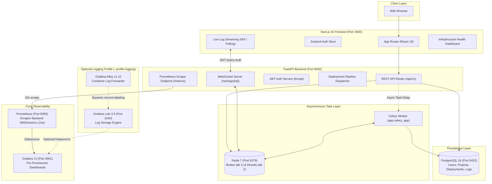

# StackForge ⚡

> **Portfolio-Grade Cloud-Native Internal Developer Platform (IDP)**
> Built as a comprehensive DevOps and Cloud Engineering project demonstrating modern containerization, asynchronous pipeline orchestration, infrastructure-as-code, and full-stack observability. Inspired by platforms like Portainer, Harness, and GitLab.

---


---

## 📌 Project Overview & Purpose

StackForge is a student-built Internal Developer Platform (IDP) created to demonstrate practical competencies across the modern Cloud Native and DevOps landscape.

### The Problem It Addresses
In microservice architectures, developers often struggle with fragmented tooling: deployment triggers, container health inspections, log tailing, and metrics monitoring frequently require jumping between multiple disconnected dashboards or CLI tools.

StackForge consolidates these operational tasks into a unified control plane:
- **Developer Self-Service:** Register microservices, inspect environment configurations, and trigger deployment workflows.
- **Asynchronous Pipeline Execution:** Offload build, test, and deployment jobs to background Celery workers with real-time log streaming.
- **Integrated Telemetry:** Monitor application performance, HTTP traffic rates, error ratios, and server metrics through unified Prometheus and Grafana dashboards.

---

## 🏗️ System Architecture

StackForge employs a microservice-inspired architecture decoupled into clear presentation, API, queuing, storage, and observability layers:



---

## 📚 Engineering Documentation Suite

StackForge includes a complete suite of industry-standard engineering documents and an interactive visual architecture viewer located in `docs/`:

| Document | Purpose & Scope | Target Audience |
| :--- | :--- | :--- |
| [**`docs/ARCHITECTURE_DIAGRAMS.html`**](docs/ARCHITECTURE_DIAGRAMS.html) | **Interactive Architecture Visualizer:** Standalone visual browser dashboard rendering interactive, zoomable HLD, LLD, K8s, Docker, and Sequence diagrams. | System Architects, Visual Learners & Interview Panels |
| [**`docs/PRD.md`**](docs/PRD.md) | **Product Requirements Document:** Vision, personas, functional capability tree, non-functional requirements, and simulated vs real boundaries. | Product Leads & Engineering Managers |
| [**`docs/Architecture.md`**](docs/Architecture.md) | **System Architecture (HLD & LLD):** 10 detailed diagrams (C4, HLD blueprint, LLD classes, Deploy Packet sequence, Docker network, K8s cluster, ERD, and Telemetry). | System Architects & Senior Engineers |
| [**`docs/RULES.md`**](docs/RULES.md) | **Engineering Standards & Conventions:** 12-factor principles, 3-tier layering diagram, Pydantic/SQLAlchemy standards, strict TypeScript, and CI PR gates. | Core Contributors & Code Reviewers |
| [**`docs/DESIGN.md`**](docs/DESIGN.md) | **UI/UX Design System:** Developer cockpit aesthetic, OKLCH tokens, atomic component hierarchy tree, and live terminal memory buffer architecture. | Frontend Engineers & UI Designers |
| [**`docs/TASK.md`**](docs/TASK.md) | **Work Breakdown Structure & Milestones:** Visual phase dependency flowchart, chronological history from Phase 1 to Phase 5, and PR #1 audit record. | Project Leads & DevOps Engineers |
| [**`docs/MEMORY.md`**](docs/MEMORY.md) | **Runtime State & Interview Study Guide:** Whiteboard interview diagram, active container registry, local credentials, 30s elevator pitch, and top 5 senior interview Q&As. | Technical Interview Prep & DevOps SREs |

---

## 🛠️ Technology Stack & Scope Clarifications

| Category | Implemented Technologies | Architecture Scope & Clarifications |
|---|---|---|
| **Frontend** | Next.js 16, React 19, TypeScript, Tailwind CSS, Zustand, Lucide Icons, Recharts | Dynamic App Router with route groups separating public auth from protected dashboard pages. |
| **Backend** | FastAPI, Python 3.12, SQLAlchemy 2.0, Pydantic v2, Passlib (bcrypt), Uvicorn | RESTful API structure with OpenAPI documentation and WebSocket endpoints. |
| **Data & Cache** | PostgreSQL 16 Alpine, Redis 7 Alpine | PostgreSQL handles relational persistence; Redis acts as Celery broker, result backend, and Pub/Sub bus. |
| **Async Execution**| Celery 5.4, Redis Broker | Background worker executing deployment pipelines with in-process `BackgroundTasks` fallback. |
| **Observability** | Prometheus v3.5.0, Grafana 12.1.1, Grafana Loki 3.5.0, Grafana Alloy v1.10.2 | Prometheus scrapes live FastAPI `/metrics`; Grafana auto-provisions datasources and dashboards. Loki/Alloy run under an optional logging profile. |
| **Containers** | Docker Engine, Docker Compose (Multi-Profile) | Multi-stage Dockerfiles with non-root security principles and isolated bridge networking. |
| **Kubernetes** | Declarative Manifests (`k8s/`) | Hardened YAML manifests (`namespace`, `secrets`, `deployments`, `services`, `probes`, `resource limits`). |
| **Infrastructure**| Terraform (`terraform/`) | Terraform configuration managing Kubernetes provider resources (alternative local IaC path). |
| **CI/CD** | GitHub Actions, GHCR | Automated linting, typechecking, pytest test isolation, and immutable SHA-tagged image builds. |

### ⚠️ Scope & Non-Implemented Components
To maintain transparency and technical accuracy for portfolio evaluations:
- **Argo CD:** Not implemented. Mentioned as an optional future extension; no active GitOps operator is running.
- **Kafka & Jaeger:** Not implemented and not part of the project architecture. Redis handles all Pub/Sub needs.
- **AWS Cloud Provisioning:** Not implemented. The project is designed for local Docker Compose and local Kubernetes environments. Terraform is configured for local Kubernetes cluster resources, not for provisioning AWS VPCs, EKS, or RDS.

---

## 📦 Container Services & Port Allocation

### Core Services (Default Profile — 7 Services)
The default runtime starts reliably across all operating systems without requiring Docker daemon socket mounts:

| Service Name | Container Name | Technology | Host Port | Internal Port | Health / Status |
|---|---|---|:---:|:---:|:---:|
| **frontend** | `stackforge-frontend` | Next.js 16 / React 19 | `3000` | `3000` | ✅ Healthy |
| **backend** | `stackforge-backend` | FastAPI / Python 3.12 | `8000` | `8000` | ✅ Healthy (`/health`) |
| **db** | `stackforge-db` | PostgreSQL 16 Alpine | `5432` | `5432` | ✅ Healthy (`pg_isready`) |
| **redis** | `stackforge-redis` | Redis 7 Alpine | `6379` | `6379` | ✅ Healthy (`redis-cli ping`) |
| **worker** | `stackforge-worker` | Celery 5.4 / Python | — | — | ✅ Running (Async Tasks) |
| **prometheus** | `stackforge-prometheus` | Prometheus v3.5.0 | `9090` | `9090` | ✅ Running (`/metrics` scrape up) |
| **grafana** | `stackforge-grafana` | Grafana 12.1.1 | `3001` | `3000` | ✅ Running (Auto-Provisioned) |

### Optional Logging Services (`--profile logging` — 2 Additional Services)
| Service Name | Container Name | Technology | Host Port | Internal Port | Health / Status |
|---|---|---|:---:|:---:|:---:|
| **loki** | `stackforge-loki` | Grafana Loki 3.5.0 | `3100` | `3100` | ⚡ Optional Profile |
| **alloy** | `stackforge-alloy` | Grafana Alloy v1.10.2 | — | `12345` | ⚡ Optional Profile |

---

## 🚦 Quick Start Guide

### Prerequisites
- **Docker:** Engine >= 24.0 & Docker Compose >= v2.20
- **Node.js:** >= 20.0 (optional, only for direct local frontend development)
- **Python:** >= 3.12 (optional, only for direct local backend development)

### 1. Clone & Configure Environment
```bash
git clone https://github.com/satviashwin369-creator/StackForge.git
cd StackForge

# Copy environment template to .env
cp .env.example .env
```

The tracked `.env.example` provides pre-configured defaults suitable for local execution. Adjust `JWT_SECRET_KEY` and passwords if desired.

### 2. Launch Core Services (Recommended)
```bash
# Build and start all 7 core containers in the background
docker compose up -d --build
```

### 3. (Optional) Launch with Full Log Aggregation
```bash
# Launch with Grafana Loki and Grafana Alloy log forwarder
docker compose --profile logging up -d
```

### 4. Verify Service Health
```bash
docker compose ps
```
All core containers should report `healthy` or `running`.

### 5. Access Platform Portals
| Portal | URL | Default Credentials / Purpose |
|---|---|---|
| **StackForge Web Dashboard** | `http://localhost:3000` | Sign Up a new user, or use demo account: `demo@stackforge.io` / `StackForge123!` *(local development only)* |
| **FastAPI Interactive Swagger** | `http://localhost:8000/docs` | OpenAPI documentation & interactive API playground |
| **Backend Health Endpoint** | `http://localhost:8000/health` | Service probe: returns `{"status": "ok"}` |
| **Prometheus Metrics** | `http://localhost:8000/metrics` | Raw Prometheus exposition format |
| **Prometheus Dashboard** | `http://localhost:9090` | Targets status: `http://localhost:9090/targets` |
| **Grafana UI** | `http://localhost:3001` | Pre-provisioned `StackForge Platform Overview` dashboard |

> [!WARNING]
> The seeded demo credentials (`demo@stackforge.io` / `StackForge123!`) are strictly intended for local development and demonstration testing. Never use these credentials in a production environment. All production deployments must configure unique user credentials and custom `JWT_SECRET_KEY` values via environment variables.

### 6. Safe Shutdown (Preserve Data)
```bash
# Stop containers while preserving database and volume data
docker compose down
```

> [!CAUTION]
> Never run `docker compose down -v` unless you intentionally wish to delete all PostgreSQL databases, user records, and Grafana volume data.

---

## 🔍 Live vs. Simulated Functionality Disclosure

To ensure transparent and credible technical presentation, StackForge clearly delineates genuine runtime operations from simulated demonstrations:

### ✅ Genuine Live Implementations
- **Authentication & Security:** Real bcrypt password hashing, dynamic JWT signing, token decoding, and protected route redirection.
- **REST APIs & Database:** Full CRUD lifecycle for projects and deployment records backed by real PostgreSQL 16 tables and SQLAlchemy 2.0 ORM sessions.
- **Task Queuing:** Real Celery asynchronous worker dispatching via Redis broker and result backend.
- **Log Streaming & WebSockets:** Real WebSocket handshakes with JWT query validation (`/api/v1/ws/logs/{id}?token=...`), Redis Pub/Sub broadcasting, and automatic HTTP polling fallback.
- **Observability:** Real Prometheus scrapes against FastAPI `/metrics` capturing live HTTP status codes, error rates, latency histograms, and process memory. Real Grafana auto-provisioning.
- **Container Log Ingestion:** Real Docker container log collection and ingestion via Grafana Alloy and Loki under the logging profile.

### ⚙️ Simulated Demonstration Features
- **Deployment Pipeline Simulation:** When a deployment is triggered, `backend/app/services/deployment_simulator.py` simulates the execution of 6 delivery stages (`Source → Build → Test → Security Scan → Deploy → Verify`) with realistic progress steps, timed delays, and log generation. StackForge **does not** spin up physical build runners or push artifacts to external cloud servers.
- **Infrastructure Fleet Telemetry:** The infrastructure dashboard (`/dashboard/infrastructure`) displays multi-server cluster metrics generated by `backend/app/services/infra_service.py` to illustrate how an enterprise IDP monitors distributed fleet health without incurring paid cloud cluster costs.

---

## 🔒 Security & Configuration Architecture

- **JWT Authentication:** Stateful token issuance with HS256 algorithm and configurable token expiry.
- **WebSocket Route Protection:** Handshakes enforce valid JWT tokens via query parameter (`?token=...`), rejecting unauthenticated requests with HTTP 403 / WebSocket close code 1008.
- **Kubernetes Secret Separation:**
  - `k8s/secret.yaml.example` is the committed template.
  - Actual `k8s/secret.yaml` is untracked and ignored by Git to prevent credential leaks.
- **Terraform Sensitive Parameterization:** Sensitive inputs (`postgres_password`, `jwt_secret_key`) are declared with `sensitive = true` and parameterized via `TF_VAR_*` or untracked `terraform.tfvars`.
- **Known Security Limitations for Local Mode:**
  - `/metrics` endpoint is currently unauthenticated to enable native Prometheus scraping. In production, this route should be restricted via internal Kubernetes network policies or an ingress gateway.
  - OAuth login buttons on the frontend UI represent UI scaffolding; third-party OAuth providers require production client ID and secret configuration.

---

## ☸️ Kubernetes & Infrastructure as Code (IaC)

StackForge provides two independent approaches for deploying to Kubernetes:

```text
k8s/                             terraform/
├── namespace.yaml               ├── main.tf
├── secret.yaml.example          ├── variables.tf
├── backend/                     ├── outputs.tf
│   ├── backend.yaml             ├── terraform.tfvars.example
│   └── worker.yaml              └── README.md
├── database/postgres.yaml
├── frontend/frontend.yaml
└── redis/redis.yaml
```

### 1. Primary Path: Declarative Kubernetes Manifests (`k8s/`)
Raw Kubernetes manifests represent the primary deployment path for local clusters (Minikube or kind):
```bash
# 1. Start local cluster
minikube start --cpus=4 --memory=4096

# 2. Apply namespace and secrets
kubectl apply -f k8s/namespace.yaml
cp k8s/secret.yaml.example k8s/secret.yaml  # adjust values locally
kubectl apply -f k8s/secret.yaml

# 3. Deploy workloads
kubectl apply -f k8s/database/
kubectl apply -f k8s/redis/
kubectl apply -f k8s/backend/
kubectl apply -f k8s/frontend/
```

### 2. Alternative Path: Terraform (`terraform/`)
Terraform configurations manage the same underlying Kubernetes resources using HashiCorp's official `kubernetes` provider.

> [!WARNING]
> **Do not apply both paths simultaneously.** Raw manifests (`k8s/`) and Terraform configurations (`terraform/`) manage overlapping resources. Applying both to the same cluster will result in resource ownership conflicts and state drift. Choose one approach.

---

## 🧪 Automated Testing & CI/CD Quality Gates

### Local Testing
```bash
# Frontend type check (zero errors)
cd frontend && npx tsc --noEmit

# Frontend lint check (zero errors, zero warnings)
cd frontend && npm run lint

# Backend automated test suite (in-memory SQLite isolation, zero PostgreSQL dependency)
cd backend && pytest tests -v
# OR via standalone runner:
cd backend && python tests/run_tests.py
```

### GitHub Actions CI/CD Pipeline
- **Triggers:** Push and Pull Request events.
- **Jobs:**
  1. **Frontend CI:** Node 20 environment executing `npm run lint`, `npx tsc --noEmit`, and `npm run build`.
  2. **Backend CI:** Python 3.12 environment executing `pytest tests -v` with in-memory SQLite isolation.
  3. **Docker Build & Publish:** Multi-service image builds for backend and frontend. Images are tagged with immutable commit SHAs. Image publishing (`:latest`) to GitHub Container Registry (GHCR) is strictly restricted to trusted pushes on the `main` branch.

---

## ⚠️ Verified Project Limitations

In the interest of full technical transparency:
1. **Deployment Pipeline is Simulated:** Delivery stages and build logs are simulated by `deployment_simulator.py`.
2. **Infrastructure Telemetry is Simulated:** Server cluster metrics are synthetic data generated by `infra_service.py`.
3. **No Cloud Infrastructure Provisioning:** StackForge does not provision actual AWS, GCP, or Azure resources.
4. **Kubernetes Runtime Not Validated Locally:** Manifests are hardened and validated syntactically; however, end-to-end runtime deployment on a live cluster was not executed during Task 2 validation due to the absence of an active local cluster (Minikube/kind).
5. **OAuth Scaffolding:** Third-party OAuth buttons require external provider credentials.
6. **Unauthenticated Metrics:** FastAPI `/metrics` is exposed without bearer token authentication.

---

## 📸 Recommended Screenshots for Portfolio

To maximize impact on GitHub and during technical interviews, capture and add these screenshots from the running environment into `docs/images/`:
1. `dashboard-overview.png`: Main dashboard showing KPI cards, recent activity stream, and health indicators.
2. `deployment-pipeline.png`: Live 6-stage pipeline visualization showing status transitions and log viewer.
3. `project-catalog.png`: Project management view showing registered microservices and repository links.
4. `grafana-dashboard.png`: Pre-provisioned Grafana `StackForge Platform Overview` displaying live Prometheus scrape metrics.

---

## 🗺️ Roadmap & Milestone Status

- [x] **Milestone 1–4:** Frontend & Backend Authentication, Session Persistence, Route Guards
- [x] **Milestone 5:** Live Dashboard APIs & Real-Time Metrics
- [x] **Milestone 6:** Project Management with PostgreSQL Persistence
- [x] **Milestone 7:** 6-Stage Deployment Pipeline with Celery Dispatch & Fallback
- [x] **Milestone 8:** Observability Stack (Prometheus Scraper, Auto-Provisioned Grafana, Optional Loki Profile)
- [x] **Milestone 9:** DevOps Hardening (Automated Test Suite, ESLint Zero Errors, Immutable CI Tagging, K8s Manifests)
- [ ] **Milestone 10 (Future Exploration):** Argo CD GitOps operator integration & live cloud deployment
