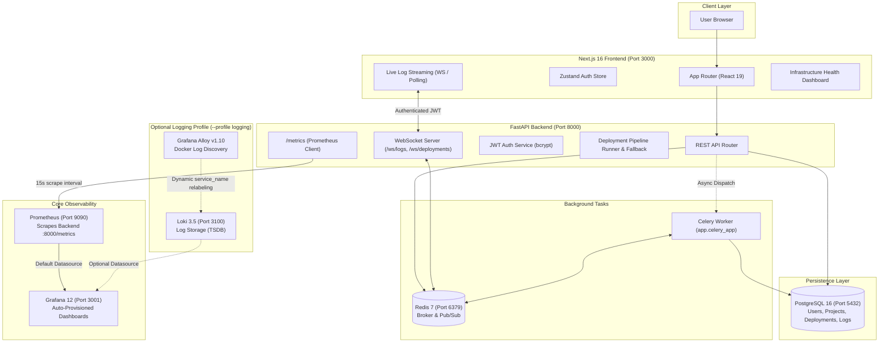

# StackForge ⚡

> **Production-Grade Cloud-Native Internal Developer Platform (IDP)**  
> Inspired by modern DevOps control planes like Portainer, Harness, and GitLab. Built to orchestrate multi-project lifecycles, continuous deployment pipelines, live container log streaming, and deep infrastructure observability.

---


---

## 📌 Executive Summary & Architecture Status

StackForge provides engineering teams with a single pane of glass for managing microservices, executing verifiable multi-stage deployment workflows, inspecting container health in real-time, and diagnosing application telemetry across a unified cloud-native ecosystem.

### Current Implementation State:
- **Phase 1 (Foundation):** ✅ **Complete** — Repository structure, Docker networks, PostgreSQL & Redis topology, Alembic database migrations.
- **Phase 2 (Authentication):** ✅ **Complete** — Full JWT authentication with bcrypt hashing, `/auth/register`, `/auth/login`, `/auth/me`, Zustand persistent auth store, and Next.js route protection.
- **Phase 3 (Platform Core & Observability):** ✅ **Complete**
  - **Dashboard API:** Live KPIs, real-time activity feed, and deployment metrics.
  - **Projects Management:** Full CRUD operations, health scores, and tech stack catalog.
  - **Deployments Pipeline:** 6-stage deployment execution (`Source → Build → Test → Security Scan → Deploy → Verify`), Celery asynchronous dispatch with resilient in-process background fallback, and duration calculation.
  - **Prometheus Telemetry:** Live scraping of FastAPI `/metrics` every 15s collecting HTTP request rates, error ratios, latency histograms, and process memory.
  - **Grafana Dashboards:** Automatic provisioning of Prometheus datasource and `StackForge Platform Overview` dashboard on container boot (`http://localhost:3001`).
  - **Optional Log Aggregation:** Grafana Loki and Alloy configured under Compose `profiles: ["logging"]` for zero-overhead default execution.
- **Phase 4 (DevOps Hardening & Quality Gates):** ✅ **Complete**
  - **Frontend Quality:** 100% strict TypeScript types and zero ESLint errors.
  - **Automated Tests:** Unit and integration test suite covering Auth, Projects CRUD, and Infrastructure endpoints with in-memory SQLite isolation.
  - **CI/CD Pipeline:** GitHub Actions workflow executing lint checks, type checks, backend tests, and multi-service image builds.
  - **Protected GHCR Publishing:** Immutable commit-SHA image tagging with protected release policy (pushes `:latest` only on trusted `main` branch merges; never from untrusted PRs).
  - **Kubernetes Manifests:** Namespace isolation, Secret abstraction, Deployments, Services, readiness/liveness probes, and CPU/memory resource limits across all services.

---

## 🏗️ System Architecture



---

## 📦 Container Services & Port Allocation

### Core Services (Default Profile)
The default runtime starts quickly and reliably across all operating systems without requiring Docker daemon socket mounts:

| Service Name | Container Name | Technology | Host Port | Internal Port | Health / Status |
|---|---|---|---|---|---|
| **frontend** | `stackforge-frontend` | Next.js 16 / React 19 | `3000` | `3000` | ✅ Healthy |
| **backend** | `stackforge-backend` | FastAPI / Python 3.12 | `8000` | `8000` | ✅ Healthy (`/health`) |
| **db** | `stackforge-db` | PostgreSQL 16 Alpine | `5432` | `5432` | ✅ Healthy (`pg_isready`) |
| **redis** | `stackforge-redis` | Redis 7 Alpine | `6379` | `6379` | ✅ Healthy (`redis-cli ping`) |
| **worker** | `stackforge-worker` | Celery 5.4 / Python | — | — | ✅ Running (Async Tasks) |
| **prometheus** | `stackforge-prometheus` | Prometheus v3.5.0 | `9090` | `9090` | ✅ Running (`/metrics` scrape up) |
| **grafana** | `stackforge-grafana` | Grafana 12.1.1 | `3001` | `3000` | ✅ Running (Auto-Provisioned) |

### Optional Logging Services (`--profile logging`)
| Service Name | Container Name | Technology | Host Port | Internal Port | Health / Status |
|---|---|---|---|---|---|
| **loki** | `stackforge-loki` | Grafana Loki 3.5.0 | `3100` | `3100` | ⚡ Optional Profile |
| **alloy** | `stackforge-alloy` | Grafana Alloy v1.10.2 | — | `12345` | ⚡ Optional Profile |

---

## 🚦 Quick Start Guide

### Prerequisites
- Docker Engine $\ge 24.0$ & Docker Compose $\ge v2.20$
- Node.js $\ge 20$ (for local frontend development/linting)
- Python $\ge 3.12$ (for local backend testing)

### 1. Clone & Configure
```bash
git clone https://github.com/satviashwin369-creator/StackForge.git
cd StackForge

# Copy environment template if not present
cp .env.example .env
```

### 2. Start Core Stack (Recommended)
```bash
# Launch the 7 core services in background
docker compose up -d --build
```

### 3. (Optional) Start with Full Log Aggregation
```bash
# Launch with Grafana Loki and Alloy log collector
docker compose --profile logging up -d
```

### 4. Verify Service Health
```bash
docker compose ps
```

### 5. Access Platform Portals
| Portal | URL | Credentials / Notes |
|---|---|---|
| **StackForge Web Dashboard** | `http://localhost:3000` | Create account via Signup or use seeded demo |
| **FastAPI Interactive Swagger** | `http://localhost:8000/docs` | Full OpenAPI specification |
| **Backend Health Endpoint** | `http://localhost:8000/health` | Returns `{"status": "ok"}` |
| **Prometheus Metrics** | `http://localhost:8000/metrics` | Raw Prometheus exposition format |
| **Prometheus Dashboard** | `http://localhost:9090` | Targets status: `http://localhost:9090/targets` |
| **Grafana UI** | `http://localhost:3001` | Default: `admin` / `admin` (Pre-provisioned Dashboard) |

---

## 🧪 Automated Testing & Quality Gates

StackForge enforces automated quality gates in both local development and CI/CD:

### Frontend Checks
```bash
cd frontend

# Verify TypeScript type correctness (zero errors)
npx tsc --noEmit

# Verify ESLint code standards (zero errors, zero warnings)
npm run lint
```

### Backend Automated Test Suite
The backend test suite covers authentication flows, duplicate user rejection, project CRUD lifecycle, user isolation, and health/telemetry endpoints with an isolated in-memory SQLite fixture:

```bash
cd backend

# Option A: Standalone test runner (zero external dependencies)
python tests/run_tests.py

# Option B: Run via pytest (when dependencies installed)
pytest tests -v
```

---

## ☸️ Kubernetes Local Deployment

Declarative, production-inspired Kubernetes manifests are located in `k8s/`:

```bash
# 1. Start a local cluster
minikube start --cpus=4 --memory=4096
# OR: kind create cluster --name stackforge

# 2. Create the namespace and secrets
kubectl apply -f k8s/namespace.yaml
kubectl apply -f k8s/secret.yaml

# 3. Deploy Database & Redis
kubectl apply -f k8s/database/
kubectl apply -f k8s/redis/

# 4. Deploy Backend and Celery Worker
kubectl apply -f k8s/backend/

# 5. Deploy Frontend
kubectl apply -f k8s/frontend/

# 6. Verify Pods and PVC Status
kubectl get pods -n stackforge
kubectl get pvc -n stackforge

# 7. Access Frontend
kubectl port-forward svc/frontend -n stackforge 3000:3000
```

---

## 📊 Live vs. Simulated Telemetry Disclosure

In accordance with transparent engineering principles:
- **Genuine Live Signals:** FastAPI `/health`, Prometheus container scrape status (`up{job="stackforge-backend"}`), live HTTP request rate (`http_requests_total`), error ratios, latency histograms (`http_request_duration_seconds`), and Python process memory usage.
- **Simulated Demonstration Data:** Infrastructure node cards (`/dashboard/infrastructure`) model multi-server cluster metrics to illustrate how an enterprise Internal Developer Platform visualizes distributed fleet telemetry without incurring paid cloud cluster costs.

---

## 📈 Roadmap

- [x] **Milestone 1–4:** Frontend & Backend Authentication, Session Persistence, Route Guards
- [x] **Milestone 5:** Live Dashboard APIs & Real-Time Metrics
- [x] **Milestone 6:** Project Management with PostgreSQL Persistence
- [x] **Milestone 7:** 6-Stage Deployment Pipeline with Celery Dispatch & Fallback
- [x] **Milestone 8:** Observability Stack (Prometheus Scraper, Auto-Provisioned Grafana, Optional Loki Profile)
- [x] **Milestone 9:** DevOps Hardening (Automated Test Suite, ESLint Zero Errors, Immutable CI Tagging, K8s Manifests)
- [ ] **Milestone 10 (Optional Extension):** Terraform AWS Cloud IaC & Argo CD GitOps Sync
