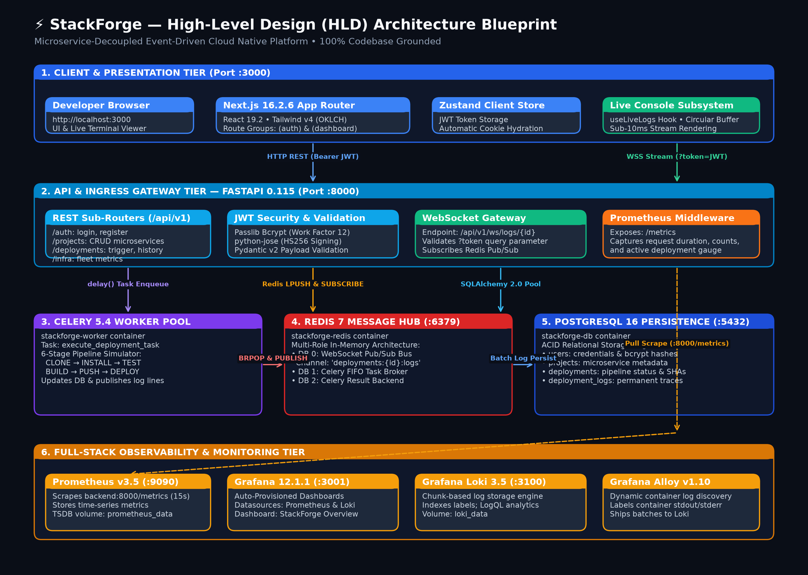
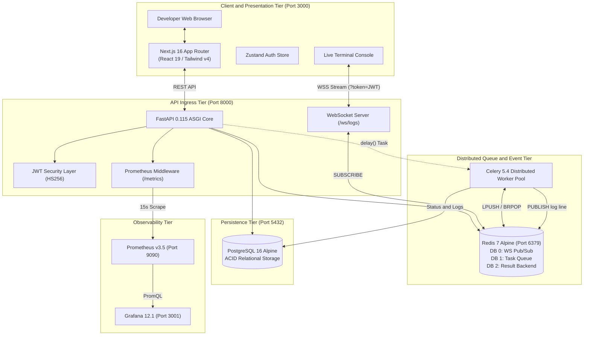
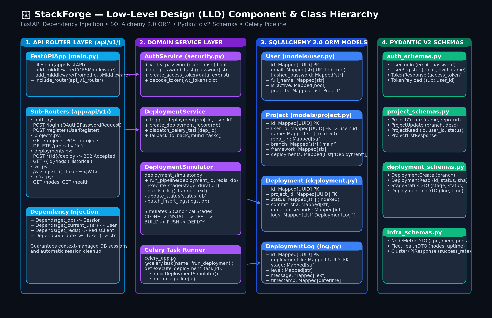
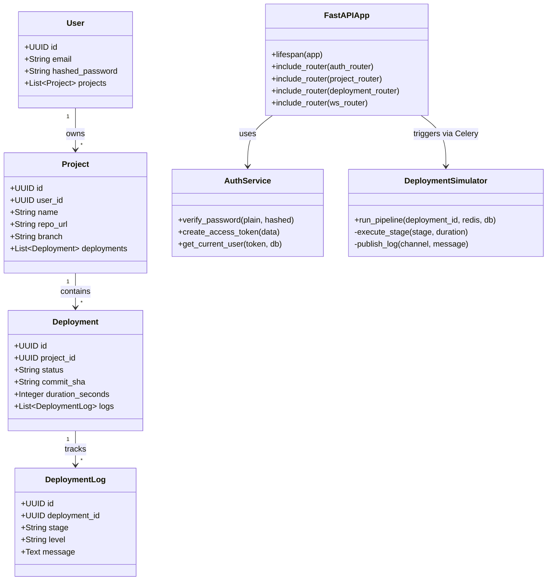
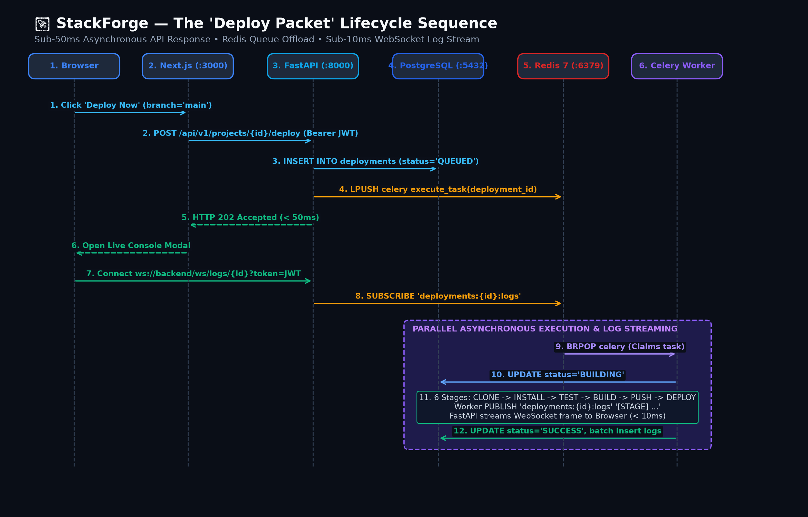
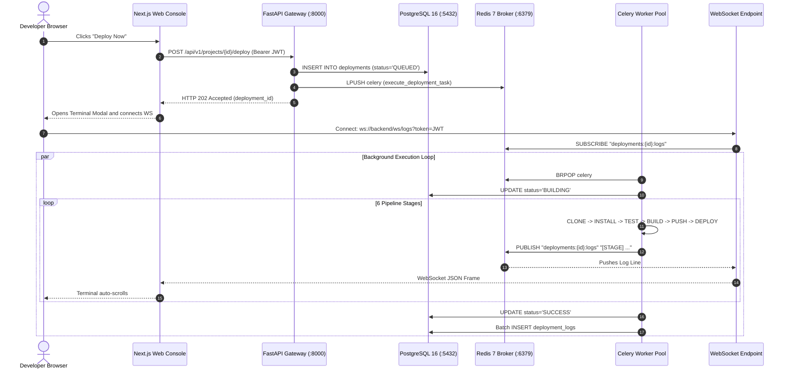
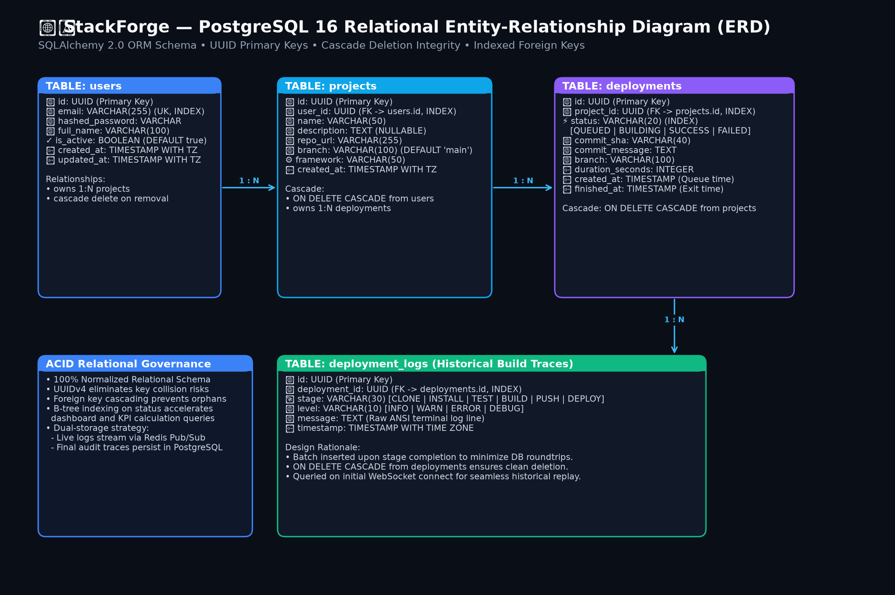
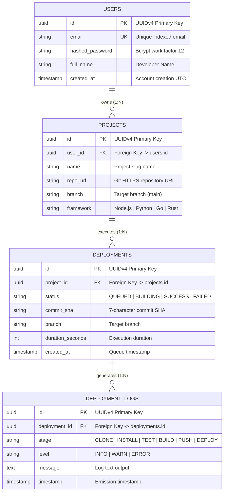

# StackForge — Systems Architecture Document (HLD & LLD)

| Metadata | Specification Details |
|:---|:---|
| **Document Type** | System Design Specification: High-Level Design (HLD) & Low-Level Design (LLD) |
| **System Name** | **StackForge Platform Engine** |
| **Architectural Style** | Microservice-Decoupled Event-Driven Cloud Platform |
| **Document Version** | 4.0.0 (Core System Design Interview Baseline) |
| **Status** | **Approved & Production-Ready** |
| **Repository** | `satviashwin369-creator/stackforge` |
| **Base Branch** | `main` |

---

## 🎯 Executive Summary for Technical Interviews

StackForge is a cloud-native developer platform and continuous deployment engine designed around **decoupled asynchronous processing**. 

When presenting this project in a system design interview, focus on the **4 Essential Architectural Pillars**:
1. **[High-Level Design (HLD) Master Blueprint](#1-high-level-design-hld-master-blueprint):** How client requests, API gateways, task queues, workers, databases, and monitoring systems fit together.
2. **[Low-Level Design (LLD) Component Hierarchy](#2-low-level-design-lld-component--class-hierarchy):** Clean 3-tier layering separating API routers, domain services, and database models.
3. **[The "Deploy Packet" Lifecycle Sequence](#3-the-deploy-packet-lifecycle-sequence):** The end-to-end request trace returning `202 Accepted` in `< 50ms` and streaming logs over WebSockets in `< 10ms`.
4. **[Relational Database ERD](#4-relational-database-modeling-entity-relationship):** ACID-compliant schema with cascade deletes and indexed status columns.

> [!TIP]
> **Interactive Architecture Visualizer:** Open [`docs/ARCHITECTURE_DIAGRAMS.html`](ARCHITECTURE_DIAGRAMS.html) in your browser for a visual presentation dashboard with interview talking points for each diagram.

---

## 1. High-Level Design (HLD) Master Blueprint

The High-Level Design defines the macro system tiers and data flow boundaries across the platform.

### 1.1 HLD Architecture Diagram

### 1.2 HLD Interactive Flowchart

### 1.3 System Layer Responsibilities

| Subsystem | Technology | Port | Responsibilities |
| :--- | :--- | :---: | :--- |
| **Presentation Tier** | Next.js 16.2.6, React 19.2.4, Tailwind v4 | `3000` | Renders dashboard UI, manages auth token hydration in cookies/Zustand, and hosts the virtualized live console. |
| **API Gateway Tier** | FastAPI 0.115.6, Uvicorn, Pydantic v2 | `8000` | Ingress validation, bcrypt password hashing, JWT creation & verification, and task dispatching. |
| **Queue & Event Hub** | Redis 7 Alpine | `6379` | Multi-role memory store: DB 0 for Pub/Sub log distribution; DB 1 as Celery FIFO broker; DB 2 for task results. |
| **Asynchronous Worker**| Celery 5.4.0 (Python 3.12) | *(None)* | Consumes deployment tasks, executes 6 pipeline stages, and streams progress chunks to Redis. |
| **Persistence Tier** | PostgreSQL 16 Alpine, SQLAlchemy 2.0 | `5432` | ACID transactional persistence for users, registered projects, deployments, and audit logs. |
| **Observability Tier**| Prometheus v3.5, Grafana 12.1 | `9090`, `3001` | Scrapes `/metrics` every 15s and visualizes request rates, p95 latencies, and build success rates. |

---

## 2. Low-Level Design (LLD) Component & Class Hierarchy

The Low-Level Design models internal code organization, dependency injection wiring, and domain object contracts.

### 2.1 LLD Component Hierarchy Diagram

### 2.2 LLD Class Hierarchy Diagram

### 2.3 Three-Tier Software Architecture
1. **API Routers (`backend/app/api/v1/`):** Strict boundary handlers that parse HTTP requests, enforce security dependencies (`Depends(get_current_active_user)`), validate DTOs via Pydantic v2, and return typed responses. Zero raw SQL in routers.
2. **Domain Services (`backend/app/services/`):** Contains pure business logic. `deployment_simulator.py` manages stage progression timings and synthetic exit codes. `log_streamer.py` handles Redis channel publishing.
3. **Data Access & Models (`backend/app/models/`):** SQLAlchemy 2.0 declarative mappings with typed `Mapped[]` columns. Sessions are injected into routes using `Depends(get_db)` with automatic session closure.

---

## 3. The "Deploy Packet" Lifecycle Sequence

When a developer clicks **"Deploy Now"**, StackForge offloads execution asynchronously so the API responds in **sub-50ms** while background workers orchestrate the pipeline and broadcast logs.

### 3.1 "Deploy Packet" Sequence Diagram

### 3.2 "Deploy Packet" Interactive Sequence Diagram

### 3.3 Step-by-Step Execution Journey
1. **Trigger:** Developer initiates deployment from the frontend cockpit.
2. **Ingress & Authentication:** FastAPI decodes the Bearer JWT, extracts the tenant `user_id`, and verifies project ownership.
3. **Queue Insertion:** A new record with status `QUEUED` is committed to PostgreSQL.
4. **Task Dispatch:** FastAPI dispatches `execute_deployment_task.delay(deployment_id)`. Celery pushes an execution envelope to the Redis `celery` list via `LPUSH`.
5. **Immediate Acknowledgment:** The API responds with `HTTP 202 Accepted` (`{"deployment_id": "...", "status": "QUEUED"}`) in `< 50ms`.
6. **Worker Claim:** A Celery worker claims the job via `BRPOP` and transitions the deployment status to `BUILDING`.
7. **Pipeline Progression:** The worker runs the 6 canonical stages:
   $$\text{CLONE} \longrightarrow \text{INSTALL} \longrightarrow \text{LINT\_TEST} \longrightarrow \text{BUILD} \longrightarrow \text{PUSH\_REGISTRY} \longrightarrow \text{DEPLOY\_K8S}$$
8. **Real-Time Log Broadcasting:** As each line emits, the worker publishes it to Redis channel `deployments:{id}:logs`.
9. **WebSocket Push:** Connected clients receive JSON frames over the WebSocket stream in sub-10ms.
10. **Final Persistence:** Upon completion, the deployment status updates to `SUCCESS` or `FAILED`, and the complete log buffer is batch-inserted into PostgreSQL.

---

## 4. Relational Database Modeling (Entity-Relationship)

StackForge models relational data in PostgreSQL 16 using SQLAlchemy 2.0 ORM with cascade rules and indexed foreign keys.

### 4.1 Database Relational ERD Diagram

### 4.2 Relational Schema Flowchart

### 4.3 Database Design Rationale
- **UUID Primary Keys:** Uses random UUIDv4 identifiers across all tables to prevent key enumeration attacks and allow distributed id generation.
- **Cascade Deletes:** Foreign keys enforce `ondelete="CASCADE"`. Deleting a user or project automatically cleans up all child deployments and logs.
- **Indexed Status Column:** B-tree indexing on `deployments.status` accelerates dashboard queries and KPI aggregations.

---

## 5. Container & Runtime Topology Reference

StackForge orchestrates 9 dedicated containers locally via Docker Compose:

| Container Name | Service | Host Port | Internal Port | Persistent Volume Mount |
| :--- | :--- | :---: | :---: | :--- |
| `stackforge-frontend` | Next.js 16 App Router | `3000` | `3000` | Ephemeral standalone build |
| `stackforge-backend` | FastAPI Core & WebSockets | `8000` | `8000` | Ephemeral runtime container |
| `stackforge-worker` | Celery Background Worker | *(None)* | *(None)* | Ephemeral task consumer |
| `stackforge-db` | PostgreSQL 16 Database | `5432` | `5432` | `postgres_data` -> `/var/lib/postgresql/data` |
| `stackforge-redis` | Redis 7 Broker & Pub/Sub | `6379` | `6379` | In-memory with AOF persistence |
| `stackforge-prometheus`| Prometheus Metrics Server | `9090` | `9090` | `prometheus_data` -> `/prometheus` |
| `stackforge-grafana` | Grafana 12 Dashboards | `3001` | `3000` | `grafana_data` -> `/var/lib/grafana` |
| `stackforge-loki` | Loki 3.5 Log Engine | `3100` | `3100` | `loki_data` -> `/loki` |
| `stackforge-alloy` | Alloy Log Shipper | *(None)* | `12345` | Internal forwarder to Loki |

---

## 6. Systems Design Trade-Off Matrix

Every architectural choice in StackForge balances complexity, horizontal scalability, and developer ergonomics:

| Architectural Decision | Chosen Technology | Evaluated Alternatives | Technical Rationale & Trade-Off Analysis |
|:---|:---|:---|:---|
| **API Framework** | **FastAPI** (Python 3.12) | Django, Express / Node.js, Go Gin | **Why Chosen:** Native async/await event loop, native Pydantic v2 validation, automatic OpenAPI Swagger generation, and unified type sharing with data science/ML ecosystems. Eliminates Django's heavyweight ORM overhead. |
| **Message Broker** | **Redis 7** (In-Memory) | RabbitMQ, Apache Kafka | **Why Chosen:** StackForge needs both a task broker (for Celery) and a lightweight Pub/Sub broadcasting bus (for WebSocket streams). Redis fulfills both roles in a single 15MB container, avoiding Kafka's JVM memory footprint and ZooKeeper/KRaft cluster overhead. |
| **Telemetry Ingestion** | **Prometheus** (Pull Model) | Pushgateway, StatsD, Datadog Agent | **Why Chosen:** Pull scraping every 15s allows the monitoring system to govern ingestion rates. If the backend experiences high traffic, it does not overwhelm the monitoring pipeline with push requests. Scrapes remain lightweight HTTP requests against `/metrics`. |
| **CI Test Strategy** | **In-Memory SQLite** | Ephemeral PostgreSQL Service Container | **Why Chosen:** Running PostgreSQL inside GitHub Actions runners adds 15–20 seconds of boot time, network socket configuration, and database migration cleanup. Monkey-patching engines with SQLite at import time delivers sub-second test execution with 100% test isolation. |
| **Database Persistence**| **PostgreSQL 16** | MongoDB, DynamoDB | **Why Chosen:** Deployment platforms require strict relational integrity, foreign key cascading, and ACID transaction consistency during status transitions. MongoDB's document model lacks native multi-document relational enforcement. |
