# StackForge — Systems Architecture Document (HLD & LLD)

| Metadata | Specification Details |
|:---|:---|
| **Document Type** | Comprehensive System Design: High-Level Design (HLD) & Low-Level Design (LLD) |
| **System Name** | **StackForge Platform Engine** |
| **Architectural Style** | Microservice-Decoupled Event-Driven Cloud Native Platform |
| **Document Version** | 3.0.0 (Visual Architecture Edition) |
| **Status** | **Approved & Production-Ready** |
| **Repository** | `satviashwin369-creator/stackforge` |
| **Base Branch** | `main` |

---

## Quick Navigation: Architecture Diagrams Index

1. [High-Level Design (HLD) Architecture Blueprint](#1-high-level-design-hld-system-architecture)
2. [Low-Level Design (LLD) Component & Class Hierarchy](#2-low-level-design-lld-component--class-hierarchy)
3. [The "Deploy Packet" Lifecycle Sequence](#3-the-deploy-packet-lifecycle--execution-sequence)
4. [Docker Container Network Topology](#4-network--docker-container-topology)
5. [Kubernetes Production Cluster Architecture](#5-kubernetes-production-cluster-architecture)
6. [PostgreSQL 1 Relational Database ERD](#6-relational-database-modeling-entity-relationship)
7. [Real-Time WebSocket Protocol State Machine](#7-real-time-websocket-protocol--state-machine)
8. [Full-Stack Observability & Telemetry Pipeline](#8-observability--telemetry-dataflow-architecture)
9. [Automated CI/CD Release Pipeline](#9-automated-cicd--artifact-release-pipeline)
10. [Systems Design Trade-Off Matrix](#10-systems-design-trade-off-matrix)

> [!TIP]
> **Interactive Browser Visualizer:** For an interactive, zoomable presentation experience with 9 tabbed diagrams and interview talking points, open [`docs/ARCHITECTURE_DIAGRAMS.html`](ARCHITECTURE_DIAGRAMS.html) directly in Chrome, Edge, or Firefox.

---

## 1. High-Level Design (HLD) System Architecture

StackForge separates interactive presentation, synchronous API ingress, asynchronous background execution, relational persistence, and full observability into dedicated container boundaries.

### 1.1 HLD Visual Architecture Diagram

▶ Click to view Mermaid.js source for HLD Diagram

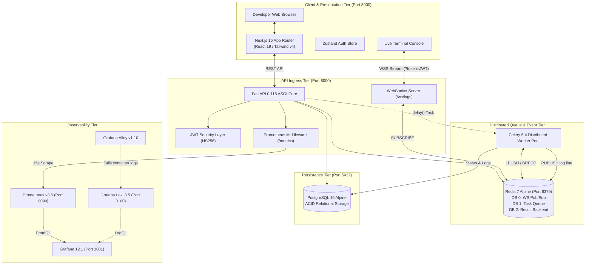

### 1.2 System Layer Responsibilities

| Subsystem | Technology | Port | Responsibilities |
| :--- | :--- | :---: | :--- |
| **Presentation Tier** | Next.js 16.2.6, React 19.2.4, Tailwind v4 | `3000` | Renders dashboard UI, manages auth token hydration in cookies/Zustand, and hosts the virtualized live console. |
| **API Gateway Tier** | FastAPI 0.115.6, Uvicorn, Pydantic v2 | `8000` | Ingress validation, bcrypt password hashing, JWT creation & verification, and task dispatching. |
| **Queue & Event Hub** | Redis 7 Alpine | `6379` | Multi-role memory store: DB 0 for Pub/Sub log distribution; DB 1 as Celery FIFO broker; DB 2 for task results. |
| **Asynchronous Worker**| Celery 5.4.0 (Python 3.12) | *(None)* | Consumes deployment tasks, executes 6 pipeline stages, and streams progress chunks to Redis. |
| **Persistence Tier** | PostgreSQL 16 Alpine, SQLAlchemy 2.0 | `5432` | ACID transactional persistence for users, registered projects, deployments, and audit logs. |
| **Observability Tier**| Prometheus v3.5, Grafana 12.1, Loki 3.5 | `9090`, `3001`, `3100` | Scrapes `/metrics` every 15s, collects container logs via Alloy, and auto-provisions monitoring dashboards. |

---

## 2. Low-Level Design (LLD) Component & Class Hierarchy

The Low-Level Design models internal code organization, dependency injection wiring, and domain object contracts.

### 2.1 LLD Visual Component & Class Diagram

▶ Click to view Mermaid.js source for LLD Diagram

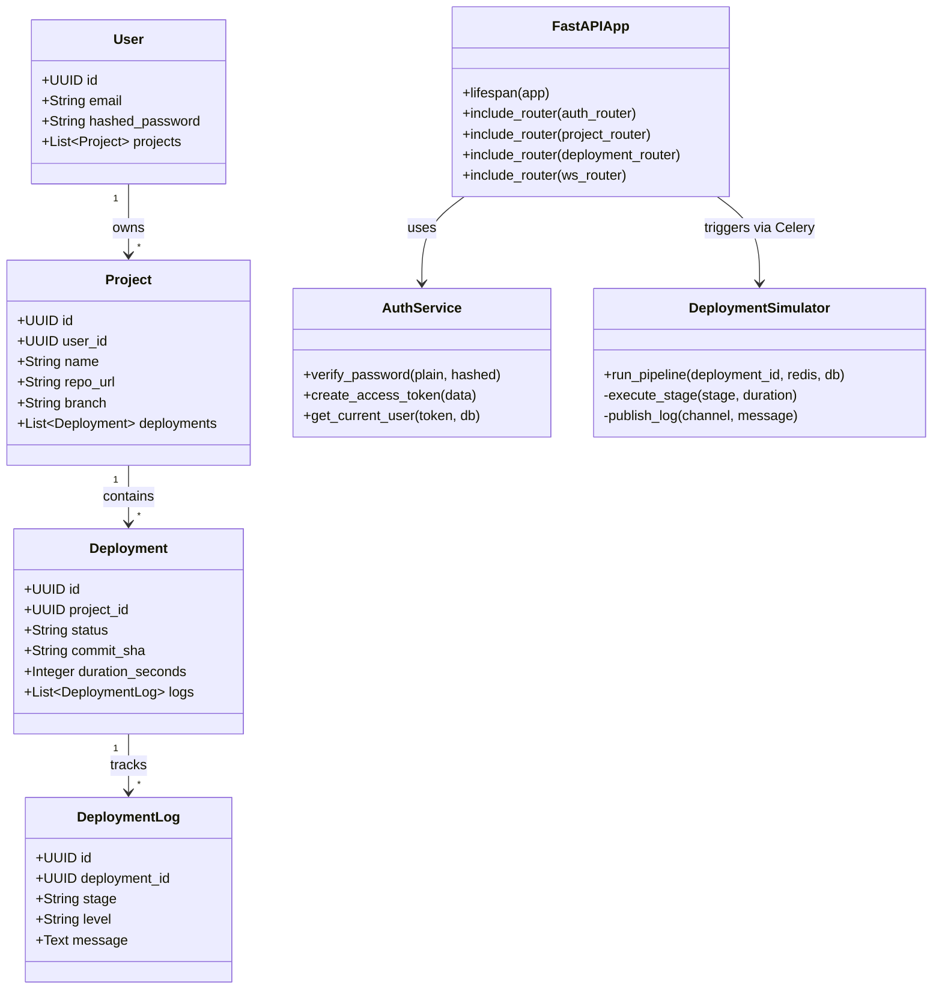

### 2.2 Three-Tier Software Architecture
1. **API Routers (`backend/app/api/v1/`):** Strict boundary handlers that parse HTTP requests, enforce security dependencies (`Depends(get_current_active_user)`), validate DTOs via Pydantic v2, and return typed responses. Zero raw SQL in routers.
2. **Domain Services (`backend/app/services/`):** Contains pure business logic. `deployment_simulator.py` manages stage progression timings and synthetic exit codes. `log_streamer.py` handles Redis channel publishing.
3. **Data Access & Models (`backend/app/models/`):** SQLAlchemy 2.0 declarative mappings with typed `Mapped[]` columns. Sessions are injected into routes using `Depends(get_db)` with automatic session closure.

---

## 3. The "Deploy Packet" Lifecycle & Execution Sequence

When a developer clicks **"Deploy Now"**, StackForge offloads execution asynchronously so the API responds in **sub-50ms** while background workers orchestrate the pipeline and broadcast logs.

### 3.1 "Deploy Packet" Visual Sequence Diagram

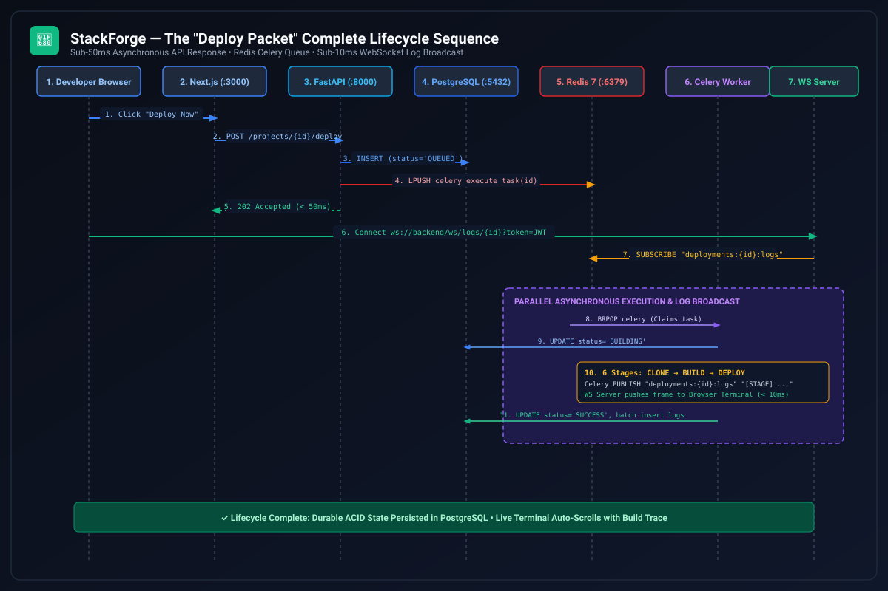

▶ Click to view Mermaid.js source for Sequence Diagram

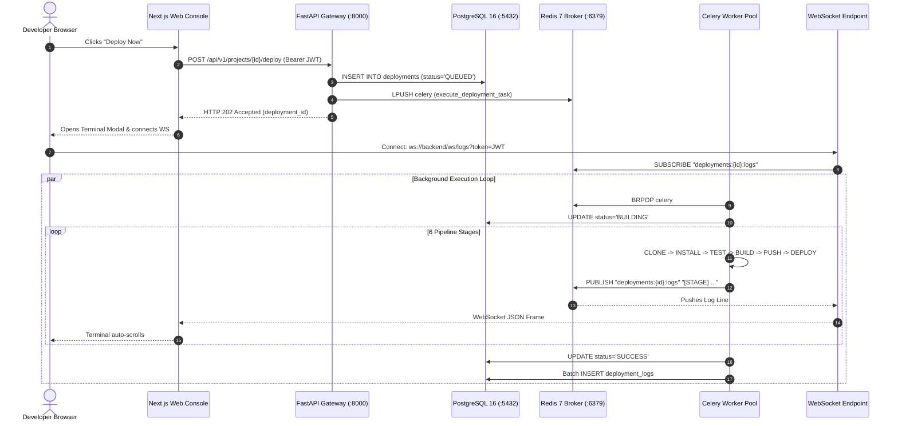

### 3.2 Step-by-Step Execution Journey
1. **Trigger:** Developer initiates deployment from the frontend cockpit.
2. **Ingress & Authentication:** FastAPI decodes the Bearer JWT, extracts the tenant `user_id`, and verifies project ownership.
3. **Queue Insertion:** A new record with status `QUEUED` is committed to PostgreSQL.
4. **Task Dispatch:** FastAPI dispatches `execute_deployment_task.delay(deployment_id)`. Celery pushes an execution envelope to the Redis `celery` list via `LPUSH`.
5. **Immediate Acknowledgment:** The API responds with `HTTP 202 Accepted` (`{"deployment_id": "...", "status": "QUEUED"}`) in `< 50ms`.
6. **Worker Claim:** A Celery worker claims the job via `BRPOP` and transitions the deployment status to `BUILDING`.
7. **Pipeline Progression:** The worker runs the 6 canonical stages:
   $$\text{CLONE} \longrightarrow \text{INSTALL} \longrightarrow \text{LINT\_TEST} \longrightarrow \text{BUILD} \longrightarrow \text{PUSH\_REGISTRY} \longrightarrow \text{DEPLOY\_K8S}$$
8. **Real-Time Log Broadcasting:** As each line emits, the worker publishes it to Redis channel `deployments:{id}:logs`.
9. **WebSocket Push:** Connected clients receive JSON frames over the WebSocket stream in sub-10ms.
10. **Final Persistence:** Upon completion, the deployment status updates to `SUCCESS` or `FAILED`, and the complete log buffer is batch-inserted into PostgreSQL.

---

## 4. Network & Docker Container Topology

StackForge manages 9 containers linked over an internal bridge network (`stackforge-network`). Only necessary ports are exposed to the host machine.

### 4.1 Docker Container Network Topology Diagram

▶ Click to view Mermaid.js source for Docker Topology

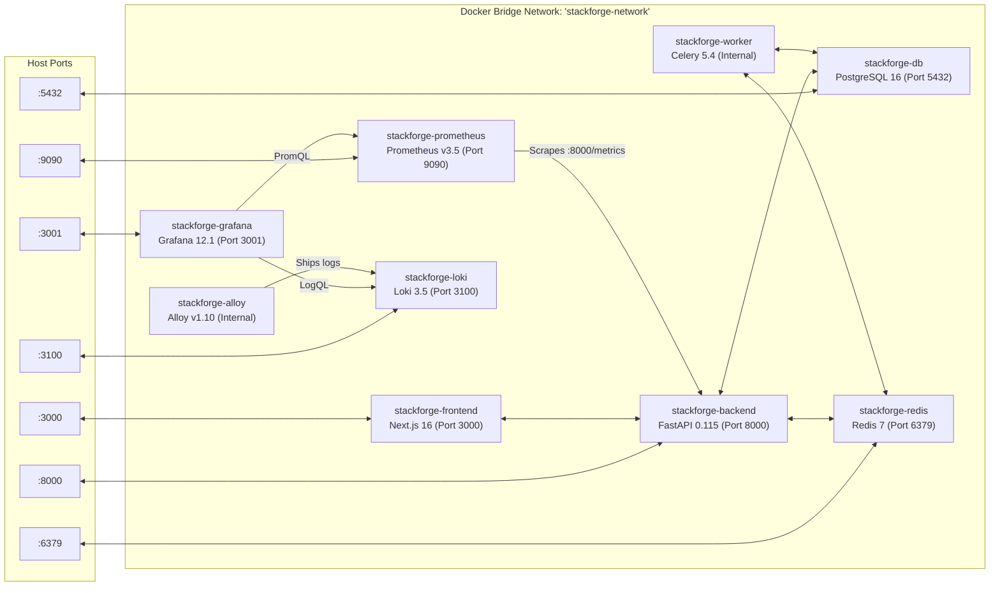

### 4.2 Port & Volume Allocation Matrix

| Container Name | Service | Host Port | Internal Port | Persistent Volume Mount |
| :--- | :--- | :---: | :---: | :--- |
| `stackforge-frontend` | Next.js 16 App Router | `3000` | `3000` | Ephemeral standalone build |
| `stackforge-backend` | FastAPI Core & WebSockets | `8000` | `8000` | Ephemeral runtime container |
| `stackforge-worker` | Celery Background Worker | *(None)* | *(None)* | Ephemeral task consumer |
| `stackforge-db` | PostgreSQL 16 Database | `5432` | `5432` | `postgres_data` -> `/var/lib/postgresql/data` |
| `stackforge-redis` | Redis 7 Broker & Pub/Sub | `6379` | `6379` | In-memory with AOF persistence |
| `stackforge-prometheus`| Prometheus Metrics Server | `9090` | `9090` | `prometheus_data` -> `/prometheus` |
| `stackforge-grafana` | Grafana 12 Dashboards | `3001` | `3000` | `grafana_data` -> `/var/lib/grafana` |
| `stackforge-loki` | Loki 3.5 Log Engine | `3100` | `3100` | `loki_data` -> `/loki` |
| `stackforge-alloy` | Alloy Log Shipper | *(None)* | `12345` | Internal forwarder to Loki |

---

## 5. Kubernetes Production Cluster Architecture

StackForge provides declarative manifests in `k8s/` structured for zero-trust security contexts and cloud-native scaling.

### 5.1 Kubernetes Cluster Visual Diagram

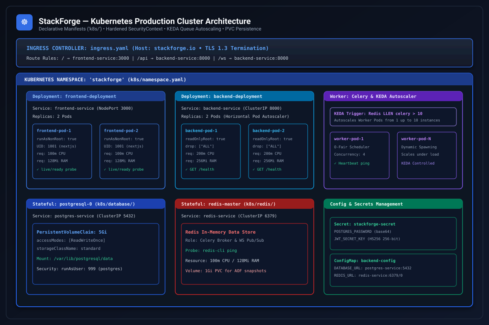

▶ Click to view Mermaid.js source for Kubernetes Architecture

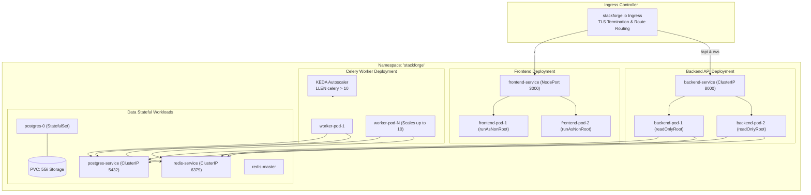

### 5.2 Kubernetes Production Hardening Specifications
- **Security Contexts:** Backend Pods enforce `readOnlyRootFilesystem: true`, `runAsNonRoot: true`, and `capabilities: { drop: ["ALL"] }`. Frontend runs as unprivileged user `nextjs` (UID 1001).
- **Resource Governance:** Explicit requests (`100m CPU`, `128Mi RAM`) and limits (`500m CPU`, `512Mi RAM`) prevent noisy-neighbor container starvation.
- **Health Probes:** Liveness and readiness HTTP probes on `/health` ensure traffic is only routed to responsive pods.
- **KEDA Autoscaling:** Celery workers autoscale from 1 to 10 replicas based on the Redis queue length (`LLEN celery > 10`).

---

## 6. Relational Database Modeling (Entity-Relationship)

StackForge models relational data in PostgreSQL 16 using SQLAlchemy 2.0 ORM with cascade rules and indexed foreign keys.

### 6.1 Database Relational ERD Diagram

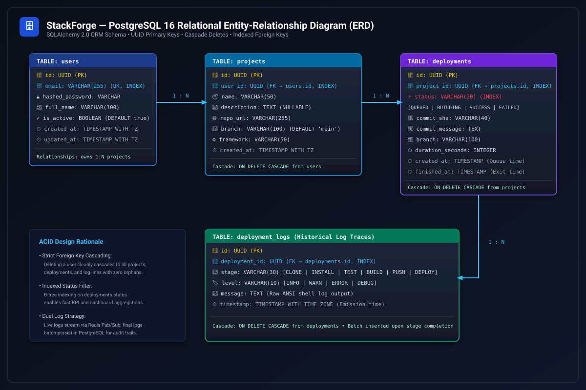

▶ Click to view Mermaid.js source for Database ERD

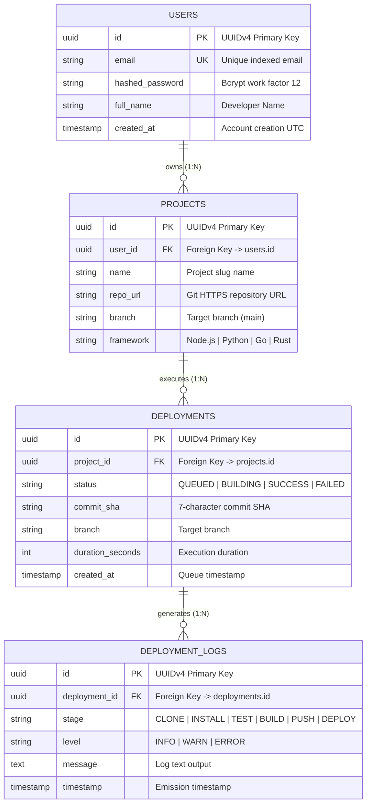

---

## 7. Real-Time WebSocket Protocol & State Machine

The real-time log streaming subsystem employs state transitions designed to survive network interruptions without dropping build traces.

### 7.1 WebSocket Protocol State Machine Diagram

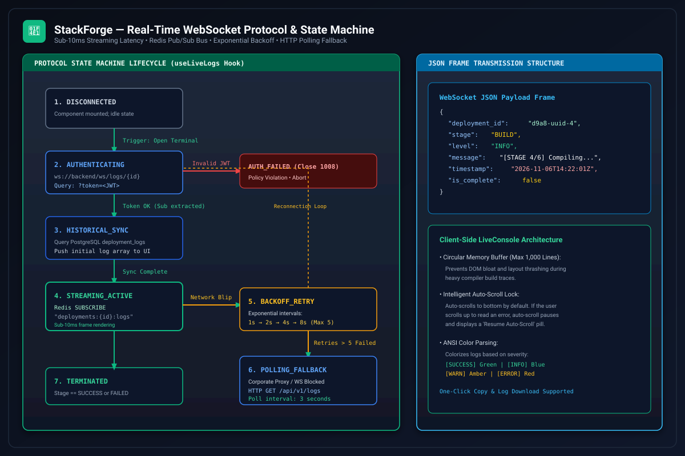

▶ Click to view Mermaid.js source for WebSocket State Machine

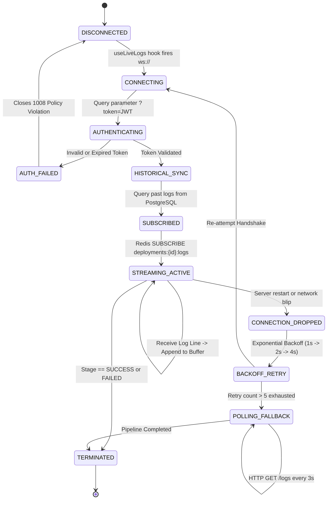

### 7.2 WebSocket Protocol Features
- **Query Parameter Auth:** Handshakes enforce valid JWT tokens via query parameter (`?token=...`), rejecting unauthenticated requests with HTTP 403 / Close Code 1008.
- **Historical Catch-Up:** Queries previous log records from PostgreSQL before subscribing to the live Redis Pub/Sub channel.
- **Circular Buffer:** Frontend stores up to 1,000 log lines in memory to prevent DOM layout thrashing.
- **Auto-Scroll Override:** Automatically scrolls to bottom unless the developer scrolls up to inspect an error.

---

## 8. Observability & Telemetry Dataflow Architecture

StackForge implements an enterprise telemetry architecture separating numeric time-series metrics from high-throughput log streams.

### 8.1 Observability Dataflow Diagram

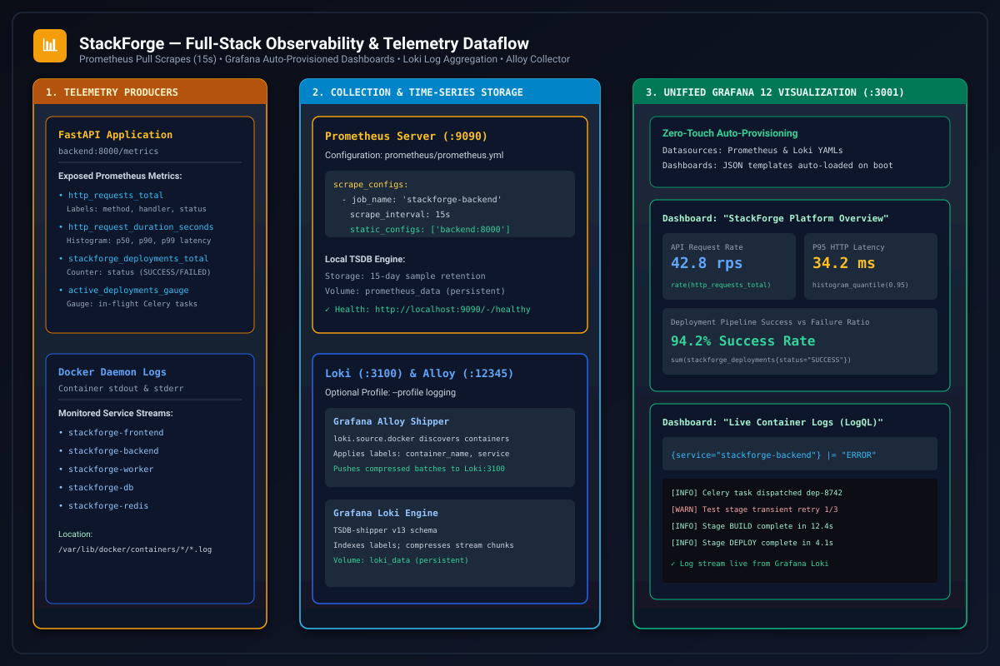

▶ Click to view Mermaid.js source for Observability Pipeline

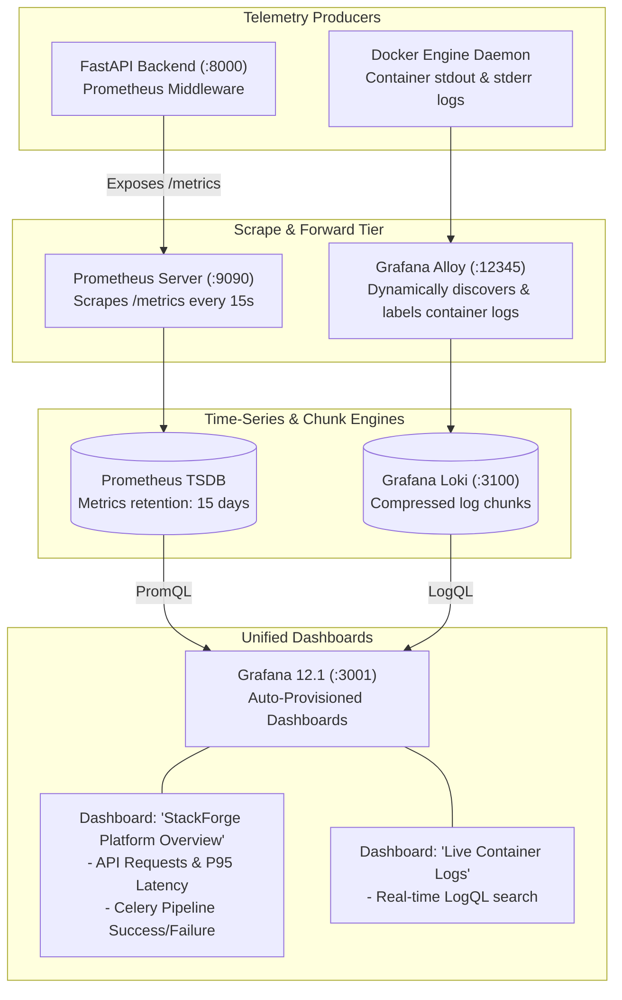

---

## 9. Automated CI/CD & Artifact Release Pipeline

Every push to `main` triggers a complete multi-job matrix pipeline that validates code quality, executes hermetic tests, builds multi-stage Docker images, and publishes them to GitHub Container Registry (GHCR).

### 9.1 CI/CD Release Pipeline Diagram

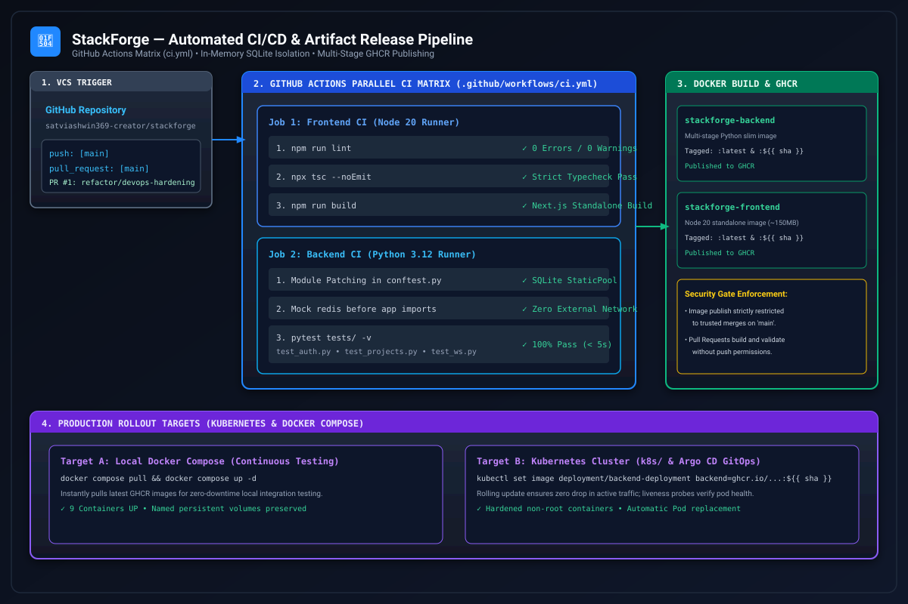

▶ Click to view Mermaid.js source for CI/CD Pipeline

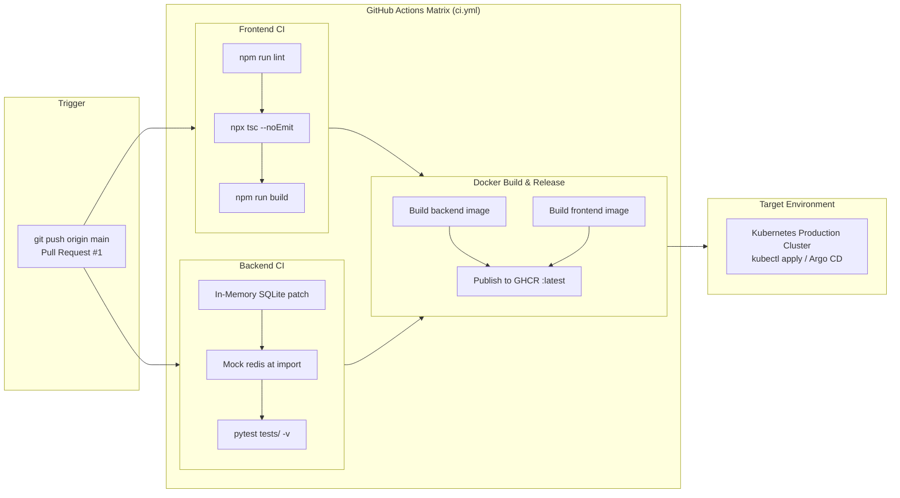

---

## 10. Systems Design Trade-Off Matrix

Every architectural choice in StackForge balances complexity, horizontal scalability, and local developer ergonomics:

| Architectural Decision | Chosen Technology | Evaluated Alternatives | Technical Rationale & Trade-Off Analysis |
|:---|:---|:---|:---|
| **API Framework** | **FastAPI** (Python 3.12) | Django, Express / Node.js, Go Gin | **Why Chosen:** Native async/await event loop, native Pydantic v2 validation, automatic OpenAPI Swagger generation, and unified type sharing with data science/ML ecosystems. Eliminates Django's heavyweight ORM overhead. |
| **Message Broker** | **Redis 7** (In-Memory) | RabbitMQ, Apache Kafka | **Why Chosen:** StackForge needs both a task broker (for Celery) and a lightweight Pub/Sub broadcasting bus (for WebSocket streams). Redis fulfills both roles in a single 15MB container, avoiding Kafka's JVM memory footprint and ZooKeeper/KRaft cluster overhead. |
| **Telemetry Ingestion** | **Prometheus** (Pull Model) | Pushgateway, StatsD, Datadog Agent | **Why Chosen:** Pull scraping every 15s allows the monitoring system to govern ingestion rates. If the backend experiences high traffic, it does not overwhelm the monitoring pipeline with push requests. Scrapes remain lightweight HTTP requests against `/metrics`. |
| **CI Test Strategy** | **In-Memory SQLite** | Ephemeral PostgreSQL Service Container | **Why Chosen:** Running PostgreSQL inside GitHub Actions runners adds 15–20 seconds of boot time, network socket configuration, and database migration cleanup. Monkey-patching engines with SQLite at import time delivers sub-second test execution with 100% test isolation. |
| **Kubernetes Path** | **Declarative YAML (`k8s/`)** | Helm Charts, Pure Terraform Kubernetes | **Why Chosen:** Declarative manifests are universally transparent for portfolio evaluation and local Minikube testing without requiring Helm template compilation or Terraform remote state locking. |
