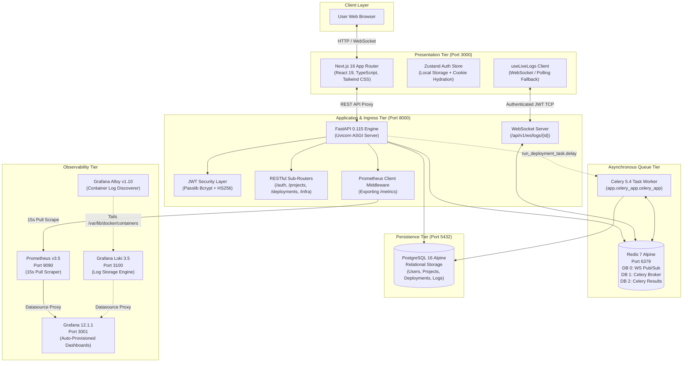
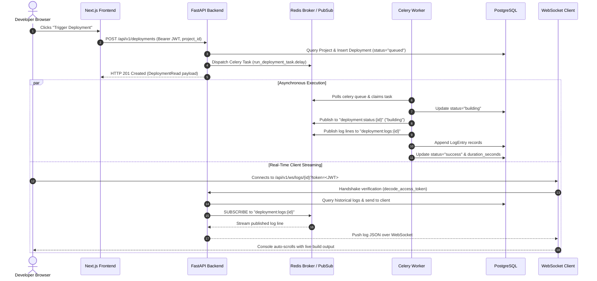
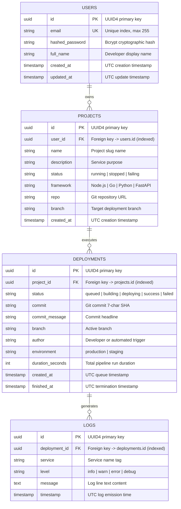

# StackForge — Systems Architecture Document (HLD & LLD)

| Metadata | Specification Details |
|:---|:---|
| **Document Type** | High-Level Design (HLD) & Low-Level Design (LLD) |
| **System Name** | **StackForge Platform Engine** |
| **Architectural Style** | Microservice-Inspired Decoupled Architecture |
| **Document Version** | 1.0.0 (Release Baseline) |
| **Status** | **Approved & Released** |

---

## 1. System Context & C4 Topological Model

StackForge is engineered as a decoupled, multi-tier Cloud Native platform. The system separates interactive client presentation, synchronous API ingress, asynchronous background task queuing, relational storage, and real-time observability into dedicated containerized boundaries.



---

## 2. High-Level Design (HLD)

### 2.1 Component Layer Responsibilities

| Tier / Subsystem | Primary Technologies | Operational Responsibilities |
|:---|:---|:---|
| **Presentation Tier** | Next.js 16, React 19, TypeScript, Tailwind CSS, Lucide, Recharts | Renders developer dashboard, manages client authentication state, executes rewrite proxies to backend, and maintains live streaming log consoles. |
| **API Ingress Tier** | FastAPI 0.115, Uvicorn, SQLAlchemy 2.0, Pydantic v2 | Validates incoming payloads, issues signed JWT tokens, enforces role-based endpoint access, executes project CRUD, and coordinates Celery task dispatches. |
| **Asynchronous Queue Tier**| Celery 5.4, Redis 7 (broker `db 1`, results `db 2`) | Consumes background pipeline tasks, manages execution state transitions, and streams step-by-step progress logs to Redis channels. |
| **Persistence Tier** | PostgreSQL 16 Alpine, SQLAlchemy ORM | Guarantees ACID relational consistency for user credentials, microservice catalog metadata, historical deployment runs, and system audit logs. |
| **Core Observability** | Prometheus v3.5, Grafana 12.1 | Scrapes application runtime performance metrics (latency, HTTP error rates, memory) and visualizes platform KPIs without manual dashboard creation. |
| **Advanced Logging Profile**| Grafana Loki 3.5, Grafana Alloy v1.10 | Discovers Docker container standard output streams dynamically and indexes them with service labels for centralized query analysis. |

---

## 3. Low-Level Design (LLD) & Data Packet Journeys

### 3.1 The Complete Journey of a "Deploy" Packet
To understand how StackForge achieves zero-blocking asynchronous execution, trace the exact lifecycle of an execution request:



### 3.2 Resilient Fallback Mechanics

#### A. Backend Task Dispatch Fallback
In production environments, message brokers or worker processes can experience transient outages. StackForge implements an automatic in-process fallback in `backend/app/api/routes/deployments.py`:
```python
try:
    from app.celery_app import run_deployment_task
    run_deployment_task.delay(str(deployment.id))
except Exception:
    # Graceful fallback: execute in-process if Celery or Redis is offline
    background_tasks.add_task(run_deployment_pipeline, deployment.id)
```
*Design Outcome:* If Redis or the Celery worker is stopped, the user's deployment never stalls in an unhandled 500 error; FastAPI's internal `BackgroundTasks` takes over and executes the pipeline in an async background thread.

#### B. Client WebSocket Polling Fallback
Corporate firewalls, legacy proxies, or network glitches frequently terminate WebSocket connections. StackForge's React hook `useLiveLogs` in `frontend/hooks/use-live-logs.ts` guards against this:
1. It attempts to connect to `ws://localhost:8000/api/v1/ws/logs/{id}?token=...`.
2. If the connection fails or closes unexpectedly, it automatically activates an HTTP polling loop against `GET /api/v1/logs/deployment/{id}` every 3 seconds.
3. The developer continues seeing live log entries without interface interruption.

---

## 4. Relational Database Modeling (Entity-Relationship)

StackForge uses PostgreSQL 16 managed via SQLAlchemy 2.0 ORM models. The database schema strictly enforces relational integrity and user isolation:



---

## 5. Systems Design Trade-Off Matrix

Every architectural choice in StackForge represents a calculated balance between complexity, scalability, and local developer ergonomics:

| Architectural Decision | Chosen Technology | Evaluated Alternatives | Technical Rationale & Trade-Off Analysis |
|:---|:---|:---|:---|
| **API Framework** | **FastAPI** (Python 3.12) | Django, Express / Node.js, Go Gin | **Why Chosen:** Native async/await event loop, native Pydantic v2 validation, automatic OpenAPI Swagger generation, and unified type sharing with data science/ML ecosystems. Eliminates Django's heavyweight ORM overhead. |
| **Message Broker** | **Redis 7** (In-Memory) | RabbitMQ, Apache Kafka | **Why Chosen:** StackForge needs both a task broker (for Celery) and a lightweight Pub/Sub broadcasting bus (for WebSocket streams). Redis fulfills both roles in a single 15MB container, avoiding Kafka's JVM memory footprint and ZooKeeper/KRaft cluster overhead. |
| **Telemetry Ingestion** | **Prometheus** (Pull Model) | Pushgateway, StatsD, Datadog Agent | **Why Chosen:** Pull scraping every 15s allows the monitoring system to govern ingestion rates. If the backend experiences high traffic, it does not overwhelm the monitoring pipeline with push requests. Scrapes remain lightweight HTTP requests against `/metrics`. |
| **CI Test Strategy** | **In-Memory SQLite** | Ephemeral PostgreSQL Service Container | **Why Chosen:** Running PostgreSQL inside GitHub Actions runners adds 15–20 seconds of boot time, network socket configuration, and database migration cleanup. Monkey-patching engines with SQLite at import time delivers sub-second test execution with 100% test isolation. |
| **Kubernetes Path** | **Declarative YAML (`k8s/`)** | Helm Charts, Pure Terraform Kubernetes | **Why Chosen:** Declarative manifests are universally transparent for junior/mid-level portfolio evaluation and local Minikube testing without requiring Helm template compilation or Terraform remote state locking. |

---

## 6. Repository Directory Structure & Component Map

The repository maintains strict separation of concerns across infrastructure, presentation, API, and documentation modules:

```text
stackforge/
├── .github/workflows/
│   └── ci.yml                 # GitHub Actions pipeline (Frontend, Backend, GHCR Publish)
├── backend/                   # FastAPI Application Core
│   ├── app/
│   │   ├── api/routes/        # Sub-routers (auth, projects, deployments, ws, logs, infra)
│   │   ├── core/              # Config (pydantic-settings), Security (bcrypt, JWT), Logging
│   │   ├── db/                # SQLAlchemy session factory and declarative base
│   │   ├── models/            # SQLAlchemy database entities (User, Project, Deployment, Log)
│   │   ├── schemas/           # Pydantic validation schemas (Request / Response DTOs)
│   │   ├── services/          # Business logic (Auth, Deployment, Simulator, Log, Infra)
│   │   ├── utils/             # Redis client wrapper and demo database seeder
│   │   ├── celery_app.py      # Celery instance configuration and task definitions
│   │   └── main.py            # FastAPI lifespan manager, middleware, and entrypoint
│   ├── tests/                 # Automated Test Suite (Isolated SQLite fixtures)
│   │   ├── conftest.py        # Import-time engine monkey-patching fixture
│   │   ├── test_auth.py       # Authentication unit and integration tests
│   │   ├── test_projects.py   # Project CRUD lifecycle and isolation tests
│   │   ├── test_ws.py         # WebSocket authentication and token validation tests
│   │   └── run_tests.py       # Zero-dependency standalone test runner
│   ├── Dockerfile             # Multi-stage production Python container definition
│   └── requirements.txt       # Pinned production Python dependencies
├── frontend/                  # Next.js 16 Web Dashboard
│   ├── app/                   # App Router structure
│   │   ├── (auth)/            # Public route group (Login, Sign Up)
│   │   ├── dashboard/         # Protected route group (Overview, Projects, Deployments)
│   │   └── layout.tsx         # Root layout with theme and session providers
│   ├── components/            # UI components (Atomic Radix/Tailwind and Dashboard panels)
│   ├── hooks/                 # Custom React hooks (useLiveLogs, usePolling, useAsyncData)
│   ├── lib/                   # API client fetch wrappers, types, and cookie managers
│   ├── stores/                # Zustand client state stores (auth-store.ts)
│   └── Dockerfile             # Multi-stage Node.js standalone container definition
├── k8s/                       # Hardened Declarative Kubernetes Manifests
│   ├── namespace.yaml         # Dedicated 'stackforge' namespace
│   ├── secret.yaml.example    # Committed placeholder secret template
│   ├── backend/               # FastAPI & Celery Worker Deployments and Services
│   ├── database/              # PostgreSQL Deployment, ClusterIP Service, 5Gi PVC
│   ├── frontend/              # Next.js Deployment & NodePort Service
│   └── redis/                 # Redis Deployment & ClusterIP Service
├── monitoring/                # Observability Configuration
│   ├── alloy/config.alloy     # Grafana Alloy dynamic Docker container log discovery
│   ├── grafana/               # Auto-provisioned Prometheus/Loki datasources and dashboards
│   ├── loki/loki-config.yml   # Grafana Loki storage and TSDB index configuration
│   └── prometheus/            # Prometheus scrape configuration (15s backend:8000 target)
├── terraform/                 # Infrastructure as Code (HashiCorp Kubernetes Provider)
│   ├── main.tf                # Declarative Kubernetes resources (Namespace, PVC, Workloads)
│   ├── variables.tf           # Parameterized inputs with sensitive=true protection
│   └── terraform.tfvars.example # Safe credential template
├── docker-compose.yml         # Multi-profile orchestration (7 core, 2 logging)
├── PROJECT_LOG.md             # Comprehensive engineering diary and milestone log
└── README.md                  # Public portfolio presentation and quick-start guide
```
