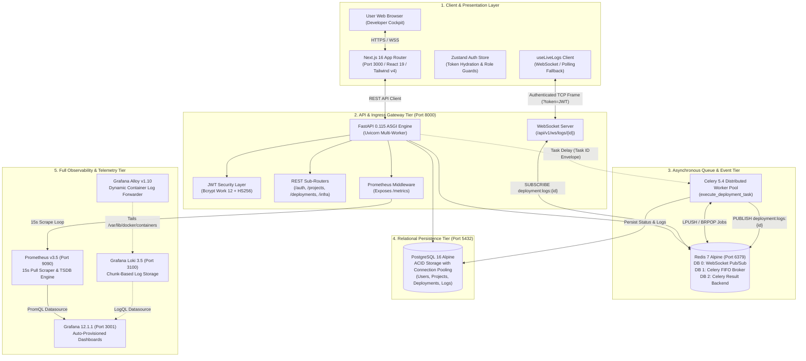
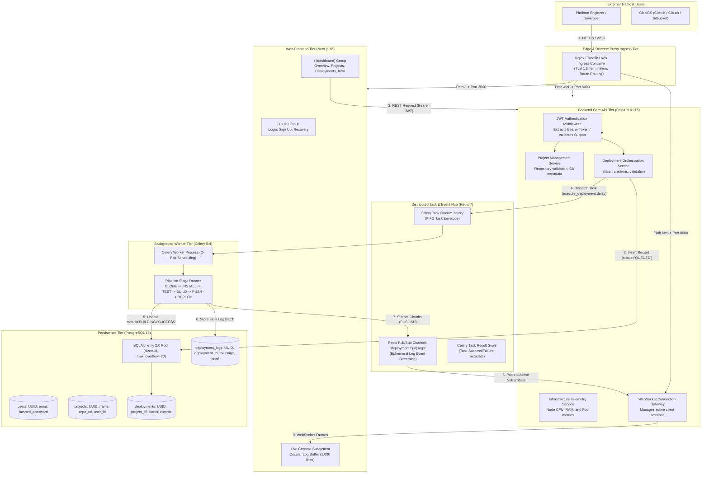
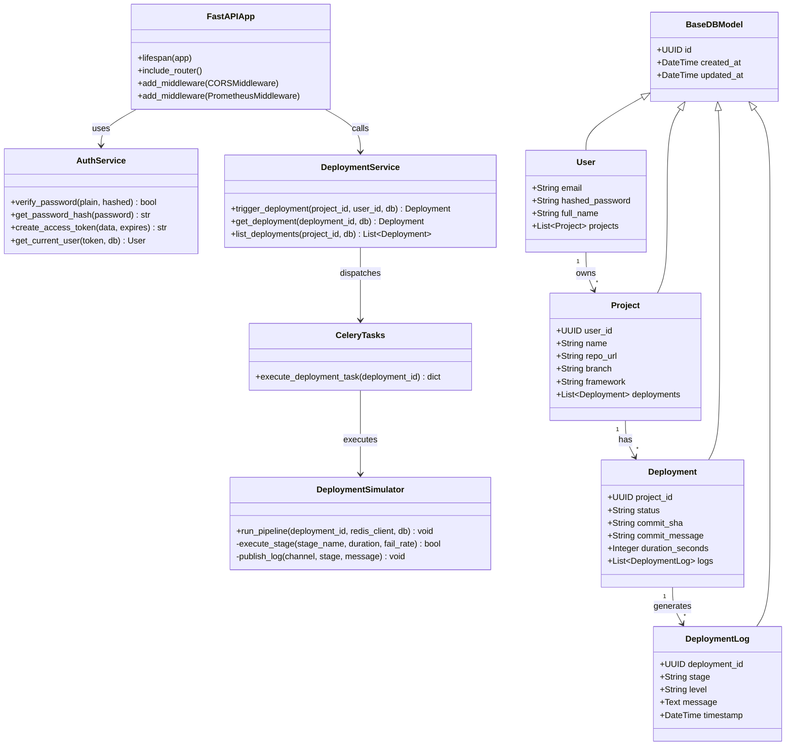
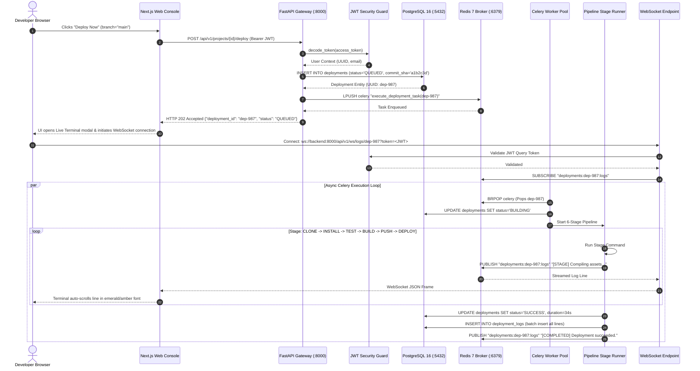
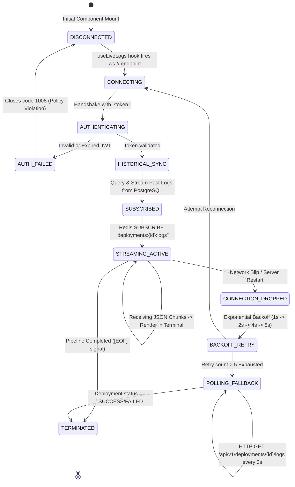
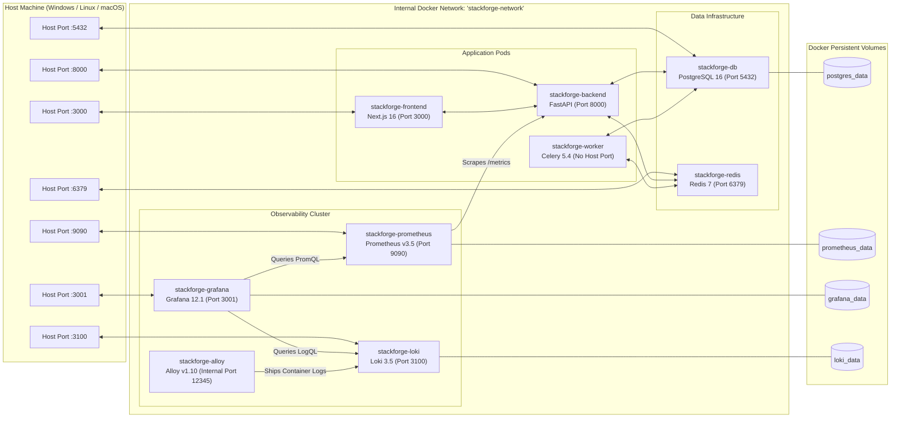
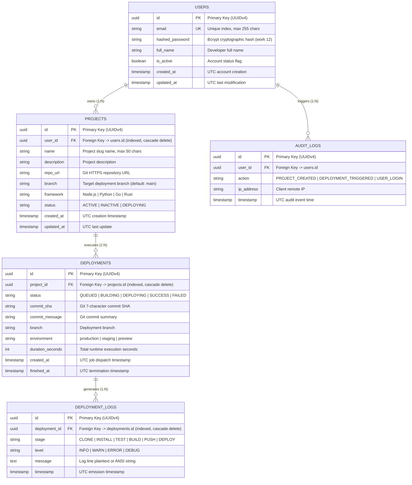
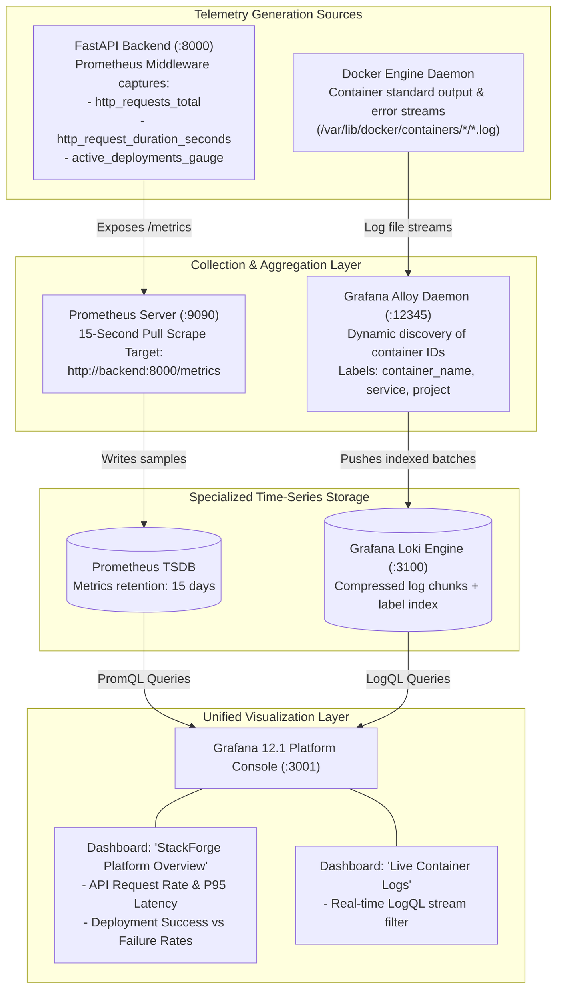
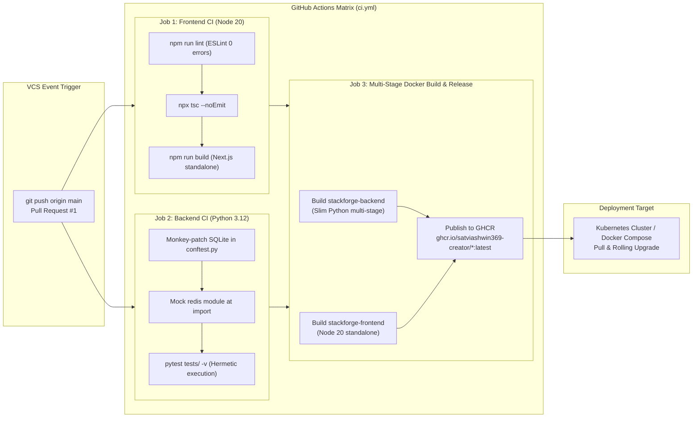

# StackForge — Systems Architecture Document (HLD & LLD)

| Metadata | Specification Details |
|:---|:---|
| **Document Type** | Comprehensive System Design: High-Level Design (HLD) & Low-Level Design (LLD) |
| **System Name** | **StackForge Platform Engine** |
| **Architectural Style** | Microservice-Decoupled Event-Driven Cloud Native Platform |
| **Document Version** | 2.0.0 (Complete System Design Edition) |
| **Status** | **Approved & Production-Ready** |
| **Repository** | `satviashwin369-creator/stackforge` |
| **Base Branch** | `main` |

---

## 1. System Design Context & C4 Architectural Model

StackForge is engineered as a decoupled, multi-tier Cloud Native developer platform. The system cleanly separates interactive client presentation, synchronous API ingress, asynchronous background task queuing, relational storage, and real-time observability into dedicated, isolated container boundaries.

### 1.1 C4 Context & Container Topology Diagram

---

## 2. High-Level Design (HLD) — System Design Blueprint

The High-Level Design defines the system boundaries, ingress pathways, decoupled microservices, and protocols that govern how traffic flows through the platform.

### 2.1 Complete HLD Architecture Blueprint

---

## 3. Low-Level Design (LLD) — Component & Class Hierarchy

The Low-Level Design defines the internal software architecture, dependency injection contracts, and object relationships across backend and frontend codebases.

### 3.1 Backend Class & Component Architecture

---

## 4. The "Deploy Packet" Lifecycle & Execution Sequence

When a developer clicks **"Deploy Now"**, StackForge offloads execution asynchronously so the API responds in sub-50ms while background workers orchestrate the pipeline.

### 4.1 Detailed Sequence Diagram

---

## 5. Real-Time WebSocket & Connection Protocol State Machine

The real-time log streaming subsystem employs state transitions designed to survive network interruptions without dropping build traces.

### 5.1 Protocol State Machine Diagram

---

## 6. Network & Docker Container Topology Diagram

StackForge manages 9 containers linked over an internal bridge network (`stackforge-network`). Only necessary ports are exposed to the host machine.

### 6.1 Container Network & Volume Topology Diagram

---

## 7. Kubernetes Production Cluster Architecture Diagram

StackForge provides declarative manifests in `k8s/` structured for zero-trust security contexts and cloud-native scaling.

### 7.1 Kubernetes Pod & Ingress Topology

```mermaid
flowchart TD
    subgraph IngressLayer ["Kubernetes Ingress & TLS Gateway"]
        Ingress["Ingress: stackforge.io<br/>(TLS termination, path routing)"]
    end

    subgraph NamespaceStackforge ["Namespace: 'stackforge'"]
        subgraph FrontendWorkload ["Frontend Deployment"]
            Svc_FE["Service: frontend-service<br/>(NodePort :3000)"]
            Pod_FE1["Pod: frontend-replica-1<br/>(runAsNonRoot: true)"]
            Pod_FE2["Pod: frontend-replica-2<br/>(runAsNonRoot: true)"]
        end

        subgraph BackendWorkload ["Backend API Deployment"]
            Svc_BE["Service: backend-service<br/>(ClusterIP :8000)"]
            Pod_BE1["Pod: backend-replica-1<br/>(readOnlyRoot: true)"]
            Pod_BE2["Pod: backend-replica-2<br/>(readOnlyRoot: true)"]
            Pod_BE3["Pod: backend-replica-3<br/>(readOnlyRoot: true)"]
        end

        subgraph WorkerWorkload ["Worker Deployment & Autoscaling"]
            KEDA["KEDA Autoscaler<br/>Trigger: Redis LLEN celery > 10"]
            Pod_W1["Pod: worker-replica-1"]
            Pod_W2["Pod: worker-replica-2"]
            Pod_Wn["Pod: worker-replica-N"]
        end

        subgraph StatefulServices ["Stateful Data Services"]
            Svc_PG["Service: postgres-service<br/>(ClusterIP :5432)"]
            Pod_PG["Pod: postgresql-0<br/>StatefulSet / Deployment"]
            PVC_PG[("PersistentVolumeClaim<br/>5Gi ReadWriteOnce")]

            Svc_RD["Service: redis-service<br/>(ClusterIP :6379)"]
            Pod_RD["Pod: redis-master"]
        end

        subgraph ConfigAndSecurity ["Configuration & Secrets"]
            Secret["Kubernetes Secret: stackforge-secret<br/>(POSTGRES_PASSWORD, JWT_SECRET_KEY)"]
            ConfigMap["ConfigMap: backend-config<br/>(DATABASE_URL, REDIS_URL, CORS_ORIGINS)"]
        end
    end

    Ingress -->|"Path /"| Svc_FE
    Ingress -->|"Path /api & /ws"| Svc_BE

    Svc_FE --> Pod_FE1
    Svc_FE --> Pod_FE2

    Svc_BE --> Pod_BE1
    Svc_BE --> Pod_BE2
    Svc_BE --> Pod_BE3

    Pod_BE1 --> Svc_PG
    Pod_BE1 --> Svc_RD
    Pod_BE2 --> Svc_PG
    Pod_BE2 --> Svc_RD

    KEDA -.->|"Scales Replicas (1..10)"| WorkerWorkload
    Pod_W1 --> Svc_PG
    Pod_W1 --> Svc_RD
    Pod_W2 --> Svc_PG
    Pod_W2 --> Svc_RD

    Pod_PG --- PVC_PG

    Secret -.->|"Injected via envFrom"| BackendWorkload
    Secret -.->|"Injected via envFrom"| WorkerWorkload
    ConfigMap -.->|"Injected via envFrom"| BackendWorkload
    ConfigMap -.->|"Injected via envFrom"| WorkerWorkload
```

---

## 8. Relational Database Modeling (Entity-Relationship)

StackForge models relational data in PostgreSQL 16 using SQLAlchemy 2.0 ORM with cascade rules and indexed foreign keys.

### 8.1 Detailed Entity-Relationship Diagram

---

## 9. Observability & Telemetry Dataflow Architecture

StackForge implements an enterprise telemetry architecture separating time-series metrics from high-throughput log streams.

### 9.1 Prometheus, Loki & Grafana Telemetry Pipeline

---

## 10. Automated CI/CD & Artifact Release Pipeline

Every push to `main` triggers a complete multi-job matrix pipeline that validates code quality, executes hermetic tests, builds multi-stage Docker images, and publishes them to GitHub Container Registry (GHCR).

### 10.1 GitHub Actions & Release Pipeline Diagram

---

## 11. Systems Design Trade-Off Matrix

Every architectural choice in StackForge balances complexity, horizontal scalability, and local developer ergonomics:

| Architectural Decision | Chosen Technology | Evaluated Alternatives | Technical Rationale & Trade-Off Analysis |
|:---|:---|:---|:---|
| **API Framework** | **FastAPI** (Python 3.12) | Django, Express / Node.js, Go Gin | **Why Chosen:** Native async/await event loop, native Pydantic v2 validation, automatic OpenAPI Swagger generation, and unified type sharing with data science/ML ecosystems. Eliminates Django's heavyweight ORM overhead. |
| **Message Broker** | **Redis 7** (In-Memory) | RabbitMQ, Apache Kafka | **Why Chosen:** StackForge needs both a task broker (for Celery) and a lightweight Pub/Sub broadcasting bus (for WebSocket streams). Redis fulfills both roles in a single 15MB container, avoiding Kafka's JVM memory footprint and ZooKeeper/KRaft cluster overhead. |
| **Telemetry Ingestion** | **Prometheus** (Pull Model) | Pushgateway, StatsD, Datadog Agent | **Why Chosen:** Pull scraping every 15s allows the monitoring system to govern ingestion rates. If the backend experiences high traffic, it does not overwhelm the monitoring pipeline with push requests. Scrapes remain lightweight HTTP requests against `/metrics`. |
| **CI Test Strategy** | **In-Memory SQLite** | Ephemeral PostgreSQL Service Container | **Why Chosen:** Running PostgreSQL inside GitHub Actions runners adds 15–20 seconds of boot time, network socket configuration, and database migration cleanup. Monkey-patching engines with SQLite at import time delivers sub-second test execution with 100% test isolation. |
| **Kubernetes Path** | **Declarative YAML (`k8s/`)** | Helm Charts, Pure Terraform Kubernetes | **Why Chosen:** Declarative manifests are universally transparent for junior/mid-level portfolio evaluation and local Minikube testing without requiring Helm template compilation or Terraform remote state locking. |
