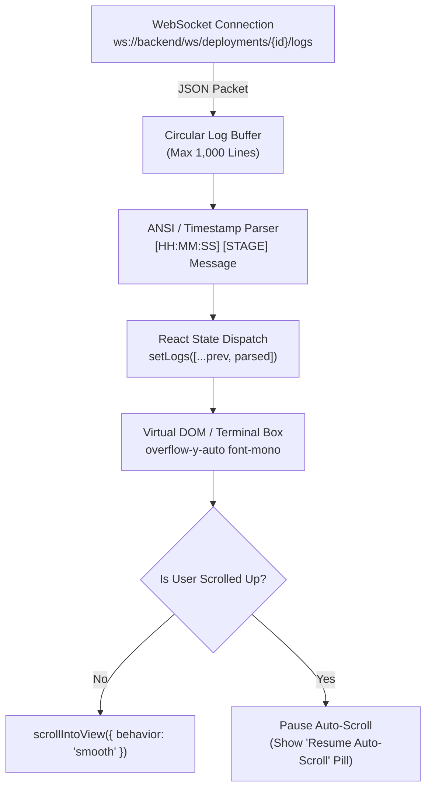

# StackForge — UI/UX Design System & Component Architecture (`DESIGN.md`)

> **Document Classification:** Design System, Frontend Architecture & Token Specification  
> **Status:** Active Standard  
> **Target Audience:** Frontend Engineers, Full-Stack Developers, Product Designers, Technical Interview Panels  
> **Framework Stack:** Next.js 16 (App Router), Tailwind CSS v4, Base UI / Radix Primitives, Lucide React, Recharts

---

## 1. Visual Identity & Design Philosophy

StackForge is designed with a **Developer Cockpit** aesthetic — modeled after mission-critical cloud management interfaces like Datadog, Portainer, Harness, and Vercel. 

### 1.1 Core Tenets
1. **High Information Density Without Clutter:** Provide engineers with immediate situational awareness of cluster health, active build stages, and error rates using compact grids, badges, and micro-charts.
2. **Dark-First Immersion:** Built natively in a modern dark theme using the **OKLCH** color space for perceptual uniformity across high-gamut displays.
3. **Calm Contrast & Semantic Accents:** Neutral charcoal backgrounds reduce visual fatigue during prolonged incident management, while vibrant semantic accents immediately draw the eye to state changes (emerald for healthy, amber for in-progress, rose for failed).
4. **Monospace Dignity:** Infrastructure metrics, Git SHAs, IP addresses, Docker container IDs, and live streaming build logs are treated as first-class citizens rendered in precision monospace type.

---

## 2. Design Tokens & Color Palette

StackForge leverages **Tailwind CSS v4** with CSS custom properties mapped directly in the modern OKLCH color space (`frontend/app/globals.css`).

### 2.1 Primary Color Tokens (Dark Theme Default)

| Token | CSS Variable | OKLCH Value | Visual Representation | Purpose |
| :--- | :--- | :--- | :--- | :--- |
| **Background** | `--background` | `oklch(0.13 0.005 260)` | Deep Charcoal Slate | Core app background canvas |
| **Card / Surface** | `--card` | `oklch(0.16 0.006 260)` | Elevated Dark Zinc | Containers, cards, modals |
| **Card Foreground**| `--card-foreground`| `oklch(0.93 0.005 260)` | Crisp Off-White | Primary text within cards |
| **Primary Brand** | `--primary` | `oklch(0.62 0.19 255)` | Electric Royal Blue | Primary actions, CTA buttons, active tabs |
| **Secondary** | `--secondary` | `oklch(0.22 0.008 260)` | Muted Charcoal | Secondary buttons, subtle backgrounds |
| **Muted Text** | `--muted-foreground` | `oklch(0.60 0.01 260)`| Slate Gray | Timestamps, helper text, labels |
| **Destructive / Error** | `--destructive` | `oklch(0.62 0.20 25)` | Crimson Rose | Failed deployments, deletion prompts |
| **Border / Divider** | `--border` | `oklch(0.25 0.01 260)` | Subtle Slate Border | Card borders, table dividers |
| **Focus Ring** | `--ring` | `oklch(0.62 0.19 255)` | Electric Blue Glow | Keyboard accessibility focus rings |

### 2.2 Telemetry & Chart Palette (Data Visualization)

| Chart Token | OKLCH Value | Hex Approx | Semantic Purpose |
| :--- | :--- | :--- | :--- |
| `--chart-1` | `oklch(0.62 0.19 255)` | `#3B82F6` | Primary Metric / Request Volume |
| `--chart-2` | `oklch(0.65 0.18 290)` | `#8B5CF6` | Secondary Metric / CPU Core Load |
| `--chart-3` | `oklch(0.68 0.17 160)` | `#10B981` | Success / Healthy Node Allocation |
| `--chart-4` | `oklch(0.70 0.15 80)` | `#F59E0B` | In-Flight Pipeline Stages / Warnings |
| `--chart-5` | `oklch(0.60 0.20 25)` | `#EF4444` | Memory Pressure / Failed Pipelines |

### 2.3 Radii & Elevation Scale

```css
--radius: 0.625rem; /* 10px base radius */
--radius-sm: calc(var(--radius) * 0.6); /* 6px */
--radius-md: calc(var(--radius) * 0.8); /* 8px */
--radius-lg: var(--radius);              /* 10px */
--radius-xl: calc(var(--radius) * 1.4); /* 14px */
```

---

## 3. Typography System

The typography hierarchy balances human legibility for navigation with technical precision for engineering data.

### 3.1 Typefaces
- **Primary Interface Font:** Geist Sans / Inter (`--font-sans`). Used for headings, navigation links, button text, and descriptions.
- **Monospace Telemetry Font:** Geist Mono (`--font-mono` / `font-mono`). Used for Git commit hashes, environment variable keys, container names, shell commands, IP addresses, and the live deployment terminal.

### 3.2 Typographic Hierarchy

| Level | Size | Weight | Tracking | Class String | Usage |
| :--- | :--- | :--- | :--- | :--- | :--- |
| **Page Title** | 24px (1.5rem) | 700 (Bold) | Tight | `text-2xl font-bold tracking-tight text-foreground` | Dashboard view headings |
| **Section Header**| 18px (1.125rem)| 600 (Semibold)| Normal| `text-lg font-semibold text-foreground` | Card titles, modal headers |
| **Card Metric** | 30px (1.875rem)| 700 (Bold) | Tight | `text-3xl font-bold tracking-tight text-foreground font-mono` | StatCard numeric values |
| **Body Text** | 14px (0.875rem)| 400 (Regular)| Normal | `text-sm text-muted-foreground` | Descriptions, table values |
| **Micro Label** | 12px (0.75rem) | 500 (Medium) | Wide | `text-xs font-medium uppercase tracking-wider text-muted-foreground` | Badge labels, table column headers |
| **Terminal Output**| 13px (0.8125rem)| 400 (Regular)| Normal | `text-xs font-mono leading-relaxed text-zinc-300` | Real-time WebSocket log lines |

---

## 4. Component Hierarchy & Atomic Design

StackForge organizes its frontend UI into modular, reusable components using the Atomic Design model:

```
frontend/
├── components/
│   ├── ui/                 # Level 1: Atoms & Primitives (Button, Badge, Input, Card)
│   ├── dashboard/          # Level 2 & 3: Molecules & Organisms
│   │   ├── StatCard.tsx
│   │   ├── DeploymentTimeline.tsx
│   │   ├── ClusterTopology.tsx
│   │   └── LiveConsole.tsx
│   └── layout/             # Level 4: Templates & Shells
│       ├── Sidebar.tsx
│       └── Header.tsx
```

### 4.1 Level 1: Atoms (Primitives)
- **StatusBadge:** Pill-shaped status indicator featuring a pulsing radial dot:
  - `SUCCESS`: Emerald border + subtle green tint (`bg-emerald-500/10 text-emerald-400 border-emerald-500/20`)
  - `BUILDING` / `QUEUED`: Amber border + animated pulse (`animate-pulse bg-amber-500/10 text-amber-400`)
  - `FAILED`: Rose border + solid red dot (`bg-rose-500/10 text-rose-400 border-rose-500/20`)
- **MetricGauge:** Miniature progress bar indicating memory, CPU, or disk utilization with dynamic color transitions at 75% and 90% thresholds.
- **Button:** Accessible button built on Base UI with support for loading states (`isLoading` shows a spinning Lucide `Loader2` icon).

### 4.2 Level 2: Molecules (Composite Widgets)
- **StatCard:** Displays a key metric (e.g., "Active Deployments", "Cluster CPU Load", "Success Rate") accompanied by a Lucide icon, trend indicator (+4.2%), and sparkline.
- **ProjectCard:** Compact card showing project repository URL, current branch, active deployment status, and quick trigger actions (`Deploy Now`, `View Logs`).

### 4.3 Level 3: Organisms (Complex Subsystems)
- **PipelineStageTimeline:** Visual horizontal stepper rendering the 6 canonical deployment stages (`CLONE`, `INSTALL`, `LINT_TEST`, `BUILD`, `PUSH_REGISTRY`, `DEPLOY_K8S`). Each node displays animated spinner icons during execution, green checkmarks upon stage completion, and red cross icons on failure.
- **ClusterTopologyGrid:** Dynamic grid visualizing simulated Kubernetes worker nodes (`node-01`, `node-02`), displaying allocated CPU/Memory sliders and active Pod badges.
- **LiveConsole:** The mission-critical terminal streaming real-time deployment logs.

---

## 5. Live Console Component Architecture

The `LiveConsole` is the central user experience element during active deployments. It must handle rapid bursts of log lines over WebSockets without freezing the browser thread.



### 5.1 Technical Implementation Details
1. **Connection State Management:** The console displays an ambient connection indicator pill:
   - Green: `CONNECTED` (Active WebSocket stream)
   - Amber: `CONNECTING` / `RECONNECTING` (Backoff retry in progress)
   - Gray: `DISCONNECTED` (Task complete or idle)
2. **Auto-Scroll Behavior:**
   - Under normal operation, each incoming log automatically scrolls the container to the bottom.
   - If the user manually scrolls up to inspect previous error messages, auto-scroll is immediately suspended, and a floating button `"Scroll to Bottom"` appears.
3. **Memory Protection (Circular Buffer):**
   - Terminal logs are capped at **1,000 lines**. When the buffer exceeds this limit, older lines are shifted out of array memory to prevent memory leaks and DOM layout thrashing.
4. **Copy & Export Controls:**
   - One-click `"Copy All Logs"` action copies the raw plain-text output to the developer's clipboard.
   - Raw `.log` download action for offline debugging.

---

## 6. Layout Systems & Responsive Breakpoints

StackForge provides a responsive dashboard layout adapted to different screen form factors:

```
+-------------------------------------------------------------------------+
| [LOGO] StackForge | Search...              [Cluster Health: OK] [Avatar]|
+------------+------------------------------------------------------------+
|  Overview  |  +------------+ +------------+ +------------+ +----------+ |
|  Projects  |  | Active Pods| | CPU Util   | | Deploy Rate| | Error %  | |
|  Deploy    |  +------------+ +------------+ +------------+ +----------+ |
|  Infra     |                                                            |
|  Logs      |  +---------------------------+ +-------------------------+ |
|  Settings  |  | Pipeline Timeline Stage   | | Live Console Terminal   | |
|            |  | [1] -> [2] -> [3] -> [4]  | | $ git clone ...         | |
|            |  +---------------------------+ | $ npm ci ...            | |
|            |  +---------------------------+ | $ docker build ...      | |
|            |  | Metric Telemetry Chart    | +-------------------------+ |
|            |  | [ Recharts Area Graph ]   |                             |
|            |  +---------------------------+                             |
+------------+------------------------------------------------------------+
```

### 6.1 Responsive Breakpoint Rules
- **Desktop (>= 1280px / `xl`):** Fixed 256px sidebar, 4-column metric cards, split-pane layout with pipeline timeline on the left and live terminal console on the right.
- **Laptop (1024px - 1279px / `lg`):** Fixed 220px sidebar, 2-column metric cards, stacked pipeline timeline and terminal console.
- **Tablet (768px - 1023px / `md`):** Icon-only collapsed sidebar (64px), single-column stacked layout.
- **Mobile (< 768px / `sm`):** Hidden sidebar accessible via a sliding hamburger drawer, full-width cards, optimized horizontal scroll for terminal logs.

---

## 7. Accessibility (a11y) & Usability Standards

- **Color Contrast:** All text-to-background combinations meet or exceed **WCAG 2.1 AA** standards (minimum 4.5:1 contrast ratio for normal text; 3:1 for large text and UI widgets).
- **Keyboard Navigation:** All interactive elements (buttons, inputs, dropdown items, tabs) are fully navigable via `Tab` and `Shift+Tab`, with clearly visible focus rings (`ring-2 ring-primary ring-offset-2 ring-offset-background`).
- **Screen Reader Support:** Status badges include screen-reader only labels (`<span className="sr-only">Status: Success</span>`). Interactive icon-only buttons include descriptive `aria-label` attributes.
- **Reduced Motion:** All CSS animations (pulsing indicators, spinners, transition fades) respect the user's OS-level accessibility preference (`@media (prefers-reduced-motion: reduce)` disables animations).
