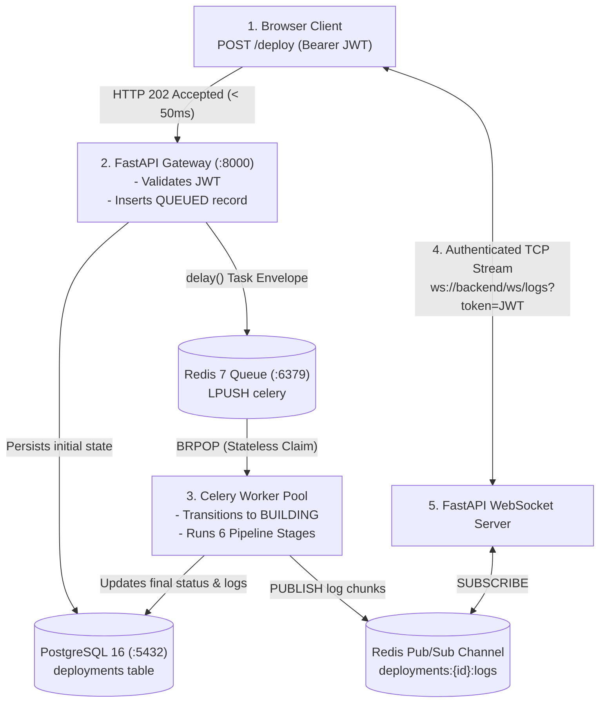

# StackForge — Living Project State & System Knowledge Base (`MEMORY.md`)

> **Document Classification:** Operational Knowledge Base, Runtime Registry & Technical Interview Guide  
> **Status:** Active Reference  
> **Last Updated:** November 2026  
> **Repository:** `satviashwin369-creator/stackforge` | **Base Branch:** `main`

---

## 1. System Snapshot & Release Status

| Parameter | Current Value | Notes |
| :--- | :--- | :--- |
| **Git Branch** | `main` | Protected branch; all PRs gated by GitHub Actions CI |
| **Commit SHA** | `0f048ea33df939a4e0de0142f46a06683864e762` | Merge commit of Pull Request #1 |
| **Pull Request** | `#1` (`refactor/devops-hardening` -> `main`)| Successfully verified & merged |
| **CI/CD Pipeline** | GitHub Actions Run `#42196587155` | Status: `SUCCESS` across all jobs |
| **GHCR Backend** | `ghcr.io/satviashwin369-creator/stackforge-backend:latest` | Multi-stage production container image |
| **GHCR Frontend**| `ghcr.io/satviashwin369-creator/stackforge-frontend:latest`| Multi-stage standalone Next.js 16 container |
| **Runtime Mode** | Docker Compose (9 Containers Active) | Local developer environment matching K8s topology |

---

## 2. Active Container & Port Registry

StackForge orchestrates 9 dedicated containers locally via Docker Compose. All services are healthy and running:

| Container Name | Service | Host Port | Internal Port | Healthcheck / Probe Endpoint |
| :--- | :--- | :--- | :--- | :--- |
| `stackforge-frontend` | Next.js 16 Web Dashboard | `3000` | `3000` | `http://localhost:3000` |
| `stackforge-backend` | FastAPI REST & WS Core | `8000` | `8000` | `http://localhost:8000/health`, `/metrics` |
| `stackforge-worker` | Celery Background Worker | *(None)* | *(None)* | Celery heartbeat via Redis ping |
| `stackforge-db` | PostgreSQL 16 Relational DB| `5432` | `5432` | `pg_isready -U postgres` |
| `stackforge-redis` | Redis 7 Broker & Pub/Sub | `6379` | `6379` | `redis-cli ping` |
| `stackforge-prometheus`| Prometheus Metrics Server | `9090` | `9090` | `http://localhost:9090/-/healthy` |
| `stackforge-grafana` | Grafana 12.1 Dashboards | `3001` | `3000` | `http://localhost:3001/api/health` |
| `stackforge-loki` | Loki 3.5 Log Aggregator | `3100` | `3100` | `http://localhost:3100/ready` |
| `stackforge-alloy` | Alloy 1.10 Telemetry Shipper| *(None)* | `12345` | Internal log forwarding pipeline |

---

## 3. Verified Credentials & Local Accounts

> [!NOTE]
> All credentials and secrets are externalized to environment variables (`.env`). No sensitive credentials are committed to version control.

### 3.1 Application Test Account
- **Web URL:** `http://localhost:3000/login`
- **Email:** Configured via `DEMO_USER_EMAIL` in `.env` (or create a new account via `/register`)
- **Password:** Configured via `DEMO_USER_PASSWORD` in `.env`
- **Role:** Administrator / Project Owner
- **Preloaded Data:** Auto-seeded demo projects and historical deployment runs.

### 3.2 Grafana Monitoring Dashboard
- **Web URL:** `http://localhost:3001`
- **Username:** `admin`
- **Password:** Configured via `GF_SECURITY_ADMIN_PASSWORD` in `.env` or set during initial local container provisioning
- **Provisioned Dashboards:** StackForge Application Telemetry, Request Latency, Celery Pipeline Throughput.

### 3.3 Database & Message Broker Connections (Internal Docker Network)
- **PostgreSQL Database:** `postgresql://${POSTGRES_USER}:${POSTGRES_PASSWORD}@db:5432/${POSTGRES_DB}`
- **Redis Broker / PubSub:** `redis://redis:6379/0`
- **Prometheus Scrape Target:** `backend:8000/metrics`

---

## 4. Architectural Decisions Quick-Reference (ADR Summary)

| Decision Question | Chosen Solution | Why? (The Engineering Trade-Off) |
| :--- | :--- | :--- |
| **Why FastAPI over Django or Flask?** | FastAPI 0.115 + Pydantic v2 | Native async ASGI support, automatic OpenAPI/Swagger generation, Pydantic type safety, and minimal memory footprint compared to monolithic Django. |
| **Why Celery + Redis over in-process background tasks?** | Celery 5.4 + Redis 7 | In-process tasks (`asyncio.create_task` or FastAPI `BackgroundTasks`) share memory and CPU with the HTTP server. Heavy builds would freeze API responses. Celery decouples execution into dedicated worker processes that scale horizontally across independent nodes. |
| **Why WebSockets over HTTP Polling or SSE?** | WebSockets (`ws://`) | HTTP polling creates `O(N * frequency)` database queries and significant network overhead. SSE is unidirectional. WebSockets offer true bidirectional, persistent full-duplex communication with sub-10ms latency for streaming terminal logs. |
| **Why Prometheus + Grafana over SaaS (Datadog/New Relic)?** | Prometheus v3.5 + Grafana 12.1 | Zero vendor lock-in, open-source CNCF standard, zero cost for local development and self-hosted Kubernetes clusters, and identical operational metrics query language (PromQL). |
| **Why Standalone Next.js Docker Build?** | `output: 'standalone'` | Reduces final frontend container image size from **~1.2 GB to ~150 MB** by copying only production dependencies and compiled `.next` artifacts. |

---

## 5. Technical Interview Master Cheat Sheet

Use this section to prepare for senior platform, software engineering, or DevOps interviews.

### 5.1 The 30-Second Elevator Pitch
> *"StackForge is a cloud-native developer platform and continuous deployment engine built with Next.js 16, FastAPI, and PostgreSQL. It decouples synchronous API traffic from heavy pipeline execution using a distributed Celery worker pool backed by Redis. As deployment stages execute, logs are published through Redis Pub/Sub and pushed to a browser terminal over authenticated WebSockets with sub-10 millisecond latency. The platform includes full observability with Prometheus metrics and automated Grafana dashboards, fully containerized and staged for Kubernetes deployment."*

---

### 5.2 Whiteboard Architecture Walkthrough (The "Deploy Packet" Lifecycle)
When the interviewer asks: *"Walk me through what happens when a developer clicks 'Deploy':"*

---

### 5.3 Top 5 Technical Interview Questions & Model Answers

#### Q1: "How do you scale Celery workers when deployment volume suddenly spikes 100x?"
**Model Answer:**
> *"Because Celery workers are stateless consumers pulling from a central Redis FIFO queue, scaling is straightforward. In Kubernetes, we deploy Celery workers as a `Deployment` managed by a **Horizontal Pod Autoscaler (HPA)** using **KEDA (Kubernetes Event-driven Autoscaling)**. 
> 
> Instead of scaling based on CPU or memory, KEDA monitors the Redis queue depth (`LLEN celery`). When the queue depth crosses a threshold (e.g., more than 10 pending tasks per worker), KEDA automatically scales worker Pods from 2 up to 50. 
> 
> Furthermore, we configure Celery with `--concurrency=4` and `-O fair` so tasks are distributed evenly across worker processes rather than pre-fetched aggressively by a single busy worker."*

#### Q2: "Why did you use Redis as both a Celery message broker and a Pub/Sub log distributor?"
**Model Answer:**
> *"Redis excels at both patterns while keeping our operational infrastructure lean. 
> 
> For Celery, Redis acts as a fast in-memory queue using Redis Lists (`LPUSH` / `BRPOP`). For log streaming, Redis provides native Pub/Sub (`PUBLISH` / `SUBSCRIBE`) with virtually zero overhead. 
> 
> The key architectural distinction is that **Celery tasks require persistence and guaranteed delivery** (at-least-once processing), whereas **log streaming is ephemeral fire-and-forget**. If no browser is currently viewing the deployment terminal, the Redis Pub/Sub message is discarded instantly with zero storage impact on RAM. For historical record, the worker concurrently persists the aggregated log buffer to PostgreSQL upon stage completion."*

#### Q3: "What happens to the WebSocket log stream if the backend server restarts during a build?"
**Model Answer:**
> *"In our frontend `LiveConsole` component, we implement an automatic exponential backoff reconnection strategy. 
> 
> If the backend drops the TCP connection, the frontend immediately enters a `RECONNECTING` state and attempts to re-establish the WebSocket connection at intervals of 1s, 2s, 4s, up to 10s. 
> 
> Because the Celery worker operates in an independent process, the deployment continues uninterrupted. Once the backend resumes, the frontend reconnects with its JWT token. To ensure the user does not miss log lines emitted during the disconnect window, the WebSocket endpoint immediately fetches the latest persisted log records from PostgreSQL before subscribing back into the live Redis Pub/Sub stream."*

#### Q4: "How do you ensure zero downtime during database schema migrations in production?"
**Model Answer:**
> *"We use Alembic migrations combined with the **Expand-and-Contract (Blue/Green) pattern**. 
> 
> We never perform destructive schema modifications (such as renaming or dropping a column) in a single release. 
> 1. In Phase 1 (Expand), we add the new column or table as nullable via an Alembic migration script and deploy it before releasing the new code.
> 2. In Phase 2, we deploy the new application version that writes to both old and new columns.
> 3. In Phase 3 (Contract), after all traffic has migrated to the new code, a final migration removes the deprecated column.
> 
> In Kubernetes, database migrations run as a Helm pre-install or pre-upgrade hook (`Job`), ensuring the database is migrated before any new application Pods start taking customer traffic."*

#### Q5: "What is simulated in StackForge today, and how would you transition it to real Kubernetes execution?"
**Model Answer:**
> *"Currently, the platform's core infrastructure — JWT auth, PostgreSQL persistence, Celery background queuing, Redis Pub/Sub, WebSockets, and Prometheus/Grafana observability — is 100% genuine production code. 
> 
> The simulated component is the **execution runner** in `deployment_simulator.py`, which emulates stage timings and shell traces, and `infra_service.py`, which generates cluster node utilization. 
> 
> To transition to 100% real cloud execution:
> 1. We replace `deployment_simulator.py` with the official **Kubernetes Python Client**.
> 2. When a deployment triggers, Celery calls `client.CoreV1Api().create_namespaced_pod()`, spawning an ephemeral Pod running a rootless container builder like **Google Kaniko** or **BuildKit**.
> 3. Kaniko clones the repo from Git, builds the container image inside the cluster without requiring a Docker daemon, and pushes it to GHCR or Amazon ECR.
> 4. We stream the container's stdout logs in real-time via `CoreV1Api().read_namespaced_pod_log(follow=True, _preload_content=False)` directly into our existing Redis Pub/Sub pipeline."*

