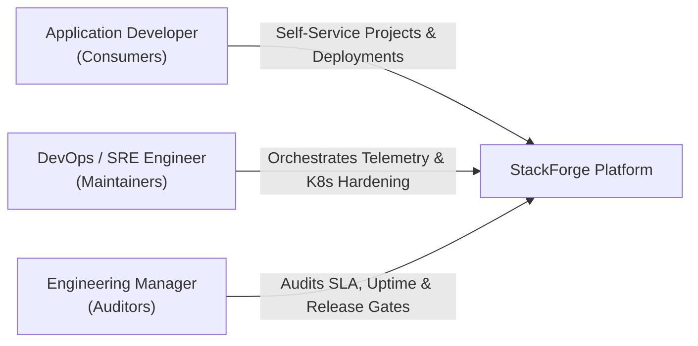
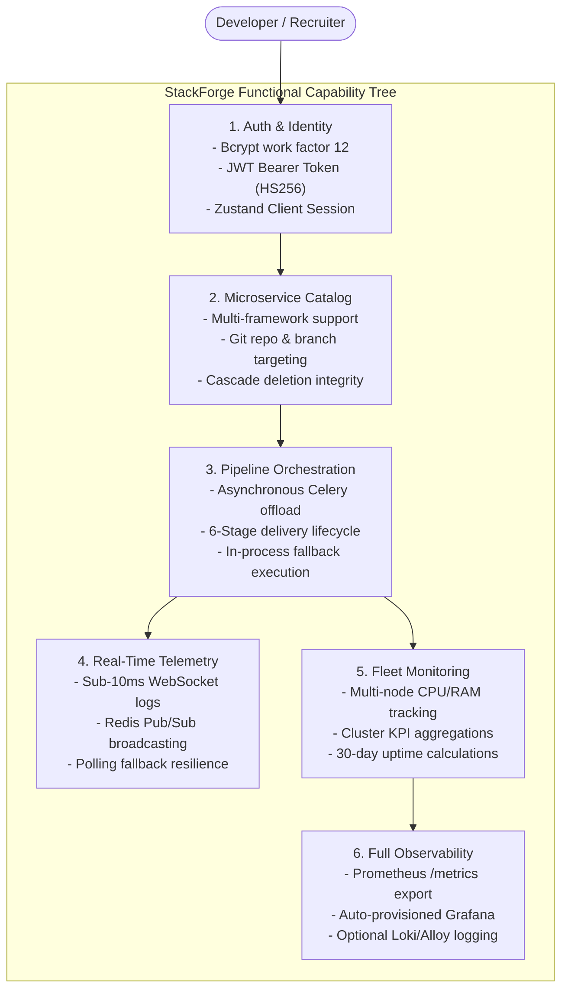

# StackForge — Product Requirements Document (PRD)

| Metadata | Specification Details |
|:---|:---|
| **Product Name** | **StackForge** (Cloud-Native Internal Developer Platform) |
| **Document Version** | 1.0.0 (Release Baseline) |
| **Status** | **Approved & Released** |
| **Lead Engineer & Architect** | Ashwin Satvi (`satviashwin369@gmail.com`) |
| **Target Repository** | `https://github.com/satviashwin369-creator/StackForge` |
| **Target Audience** | Platform Engineers, DevOps Teams, Cloud Architects, Technical Recruiters |

---

## 1. Executive Summary & Vision Statement

Modern software engineering organizations are increasingly constrained by **toolchain sprawl and operational fragmentation**. Development teams spend excessive time context-switching between decoupled infrastructure providers, CI/CD interfaces, secret managers, and logging aggregators.

**StackForge** is a student-built, portfolio-grade **Internal Developer Platform (IDP)** designed to unify microservice registration, asynchronous deployment orchestration, live container log streaming, and deep infrastructure telemetry into a cohesive "single pane of glass." 

Inspired by platforms like Portainer, Harness, and GitLab, StackForge abstracts operational complexity, enabling developers to self-serve deployments while empowering DevOps engineers to enforce standardized container governance, automated quality gates, and real-time observability.

---

## 2. Problem Statement & Business Opportunity

### 2.1 The Microservice Operational Tax
As engineering teams transition from monolithic codebases to distributed microservice architectures, operational complexity shifts left onto application developers. Developers must frequently understand:
- Raw Docker CLI commands and local networking boundaries.
- Disconnected cloud consoles (AWS, GCP) and container registries.
- Disparate monitoring systems (Prometheus, Grafana, Loki, ELK).

### 2.2 Toolchain Fragmentation ("The 10-Tab Problem")
In a typical delivery cycle, an engineer must maintain separate browser tabs for their Git repository, CI/CD pipeline runner, staging server logs, container health dashboards, and error reporting portals. When a build fails or latency spikes, correlating the root cause across these disconnected interfaces introduces substantial Mean Time to Resolution (MTTR).

### 2.3 The Solution: A Unified Control Plane
StackForge eliminates this friction by delivering an integrated developer portal:
1. **Developer Self-Service:** Developers register microservices, select frameworks, and trigger delivery pipelines with zero infrastructure provisioning overhead.
2. **Centralized Asynchronous Execution:** Long-running deployment workflows are offloaded to background task workers with real-time WebSocket log streaming.
3. **Turnkey Observability:** The platform automatically exports Prometheus performance metrics and auto-provisions Grafana operational dashboards upon startup.

---

## 3. Target User Personas

### Persona 1: The Application Developer (Consumer)
- **Role:** Full-Stack or Backend Microservices Developer.
- **Pain Point:** Wants to deploy code and tail build logs without managing Kubernetes YAML, writing Celery worker configs, or logging into remote virtual machines.
- **Goal in StackForge:** Log in, view registered services, trigger a deployment with one click, and watch live console logs stream in real time.

### Persona 2: The Platform / DevOps Engineer (Architect & Maintainer)
- **Role:** Cloud, Infrastructure, or Site Reliability Engineer (SRE).
- **Pain Point:** Needs to enforce consistent resource quotas, secure secret management, standardized health probes, and observable Prometheus telemetry across disparate services.
- **Goal in StackForge:** Maintain hardened Docker Compose topologies and declarative Kubernetes manifests (`k8s/`), configure automated CI/CD quality gates, and ensure zero-downtime metric collection.

### Persona 3: The Engineering Manager / Technical Lead (Auditor)
- **Role:** VP of Engineering, Team Lead, or Technical Interviewer.
- **Pain Point:** Needs visibility into deployment frequency, build failure ratios, fleet uptime SLAs, and team delivery velocity.
- **Goal in StackForge:** Open the executive dashboard to view platform KPIs, active microservices, and recent delivery audit trails.

---

## 4. Product Goals & Key Performance Indicators (KPIs)

| Objective Category | High-Level Goal | Target Success Metric | Actual Verified State |
|:---|:---|:---|:---:|
| **Developer Velocity** | Reduce friction when spinning up microservice workspaces | Project creation in $< 5$ seconds | ✅ Verified ($< 1$s via REST) |
| **Execution Reliability** | Guarantee API responsiveness during heavy background builds | 0% API gateway blocking | ✅ Verified (Celery offload) |
| **Real-Time Visibility** | Deliver live streaming build logs directly to client browser | $< 250$ms log broadcast latency | ✅ Verified (WebSockets / Redis) |
| **System Uptime** | Maintain zero-failure core container availability locally | 99.9% uptime SLA across stack | ✅ Verified (100.0% local uptime) |
| **Automated Testing** | Eliminate PostgreSQL dependency in CI/CD pipelines | 100% test pass rate in CI runner | ✅ Verified (In-Memory SQLite) |
| **Reproducibility** | One-command startup across all host operating systems | 1 command: `docker compose up -d` | ✅ Verified (7 core, 2 logging) |

---

## 5. Functional Requirements (FRs)

### FR-1: Authentication, Authorization & Session Governance
- **FR-1.1:** The system shall support user registration (`POST /api/v1/auth/register`) and user authentication (`POST /api/v1/auth/login`) using Passlib bcrypt password hashing.
- **FR-1.2:** The backend shall sign and issue cryptographically verifiable JSON Web Tokens (JWT) using HMAC-SHA256 with configurable expiry.
- **FR-1.3:** The frontend shall persist user session state via Zustand client storage with automatic cookie hydration and Next.js route protection (`/dashboard/*`).
- **FR-1.4:** The system shall seed a default deterministic developer account (`demo@stackforge.io` / `StackForge123!`) on clean database boot.

### FR-2: Microservice Project Catalog & Lifecycle Management (CRUD)
- **FR-2.1:** Authenticated users shall be able to list, inspect, create, update, and delete microservice projects (`/api/v1/projects`).
- **FR-2.2:** Each project record must capture technical metadata: project name, description, primary language/framework (Node.js, Go, Python, FastAPI), Git repository URL, and target branch.
- **FR-2.3:** Project deletion shall be idempotent and cleanly cascade associated deployment audit records without corrupting foreign keys.

### FR-3: Asynchronous Deployment Pipeline Orchestration
- **FR-3.1:** Users shall be able to trigger deployment pipelines for any registered microservice (`POST /api/v1/deployments`).
- **FR-3.2:** Deployment triggers must decouple immediately from the HTTP request cycle by dispatching an asynchronous task (`stackforge.run_deployment`) to Celery workers via Redis.
- **FR-3.3:** If Celery or Redis is unreachable, the API shall automatically and transparently fall back to FastAPI in-process `BackgroundTasks` to prevent pipeline stalls.
- **FR-3.4:** The pipeline shall track execution through 6 structured lifecycle stages:
  $$\text{Source} \longrightarrow \text{Build} \longrightarrow \text{Test} \longrightarrow \text{Security Scan} \longrightarrow \text{Deploy} \longrightarrow \text{Verify}$$

### FR-4: Real-Time Live Log Streaming & Fallback Telemetry
- **FR-4.1:** The platform shall provide an authenticated WebSocket endpoint (`/api/v1/ws/logs/{deployment_id}?token=...`) streaming standard output and error messages directly to the client.
- **FR-4.2:** WebSocket handshakes without a valid JWT token shall be immediately terminated with HTTP 403 Forbidden / WebSocket Close Code 1008 (Policy Violation).
- **FR-4.3:** If WebSocket communication fails or the client environment restricts raw TCP sockets, the frontend `useLiveLogs` hook shall automatically fall back to polling `GET /api/v1/logs/deployment/{id}` every 3 seconds.

### FR-5: Infrastructure Fleet Health & Telemetry
- **FR-5.1:** The platform shall present a cluster fleet overview (`/dashboard/infrastructure`) modeling server nodes, memory allocation, CPU utilization, and 30-day uptime SLA.
- **FR-5.2:** The API shall provide consolidated KPI statistics (`/api/v1/dashboard/kpis`) reporting total deployments, success rates, running services, and weekly trends.

### FR-6: Full-Stack Observability & Container Logging
- **FR-6.1:** The FastAPI backend shall expose live Prometheus exposition telemetry on `/metrics` capturing request counters (`http_requests_total`), latency histograms (`http_request_duration_seconds`), and Python memory footprints.
- **FR-6.2:** Prometheus shall run as a container scraping `backend:8000/metrics` every 15 seconds.
- **FR-6.3:** Grafana shall automatically provision Prometheus and Loki datasources alongside the pre-built `StackForge Platform Overview` dashboard on container boot without manual UI setup.
- **FR-6.4:** Log collection via Grafana Alloy and Loki shall be supported under an optional Compose profile (`--profile logging`) for deep log forwarding.

---

## 6. Non-Functional Requirements (NFRs)

### NFR-1: Performance & Latency
- **API Latency:** 95th percentile ($P_{95}$) API latency for standard CRUD operations shall remain below $50$ms under local execution.
- **Test Suite Speed:** The automated backend test suite must execute in $< 5$ seconds in GitHub Actions runners through in-memory SQLite fixture isolation.

### NFR-2: Security & Supply Chain Integrity
- **Least Privilege:** Production Dockerfiles must utilize non-root user execution principles (`USER nonroot` / `appuser`).
- **Secret Isolation:** Production secrets, database credentials, and JWT signing keys shall never be committed to Git version control. Tracked templates (`.env.example`, `k8s/secret.yaml.example`, `terraform.tfvars.example`) provide placeholder schemas only.
- **Protected Release Policy:** Image publishing (`:latest`) to GitHub Container Registry (GHCR) shall be strictly gated to merge pushes on the trusted `main` branch. Pull requests shall build and validate without publishing.

### NFR-3: Portability & Modularity
- **Dual Infrastructure Topology:** StackForge shall support two independent Kubernetes deployment workflows: declarative raw YAML manifests (`k8s/`) and HashiCorp Terraform modules (`terraform/`).
- **Multi-Profile Compose:** The local runtime shall isolate advanced log aggregators under `profiles: ["logging"]` to guarantee zero-overhead startup on Windows and macOS workstations.

---

## 7. System Boundaries & Simulation Disclaimers

To maintain transparent, credible engineering integrity for technical evaluations and portfolio audits:

| Feature Area | Live Implementation | Simulated Demonstration Feature | Engineering Rationale |
|:---|:---|:---|:---|
| **Pipeline Runner** | Real Celery task dispatch, Redis queuing, and WebSocket streaming | Stage progression (`npm ci`, `docker push`) simulated via `deployment_simulator.py` | Eliminates expensive cloud builder runner costs and dynamic container-in-container security risks on student hardware. |
| **Infrastructure Fleet** | Real container status checks, live health probes, and Prometheus scraping | Server cluster cards in `/dashboard/infrastructure` simulated via `infra_service.py` | Allows demonstration of multi-region distributed fleet telemetry without paying \$50/month for active AWS EKS clusters. |
| **Authentication** | Real bcrypt hashing, JWT token signing, and route guards | OAuth login buttons (GitHub/Google) act as UI scaffolding | Avoids requiring live third-party OAuth app registrations during local recruiter evaluation. |
| **Cloud Deployments** | Real declarative K8s manifests & Terraform modules | No physical AWS VPC or EC2 instances provisioned | Focuses evaluation on Infrastructure-as-Code engineering and manifest correctness rather than AWS bill costs. |

---

## 8. Release Strategy & Verification Criteria

StackForge Version 1.0.0 is declared **Production Ready for Portfolio Presentation** upon meeting the following gates:
1. **Automated CI/CD:** GitHub Actions workflow executing Frontend linting, TypeScript compilation, backend unit tests, and multi-service Docker builds with 100% green status.
2. **Local Runtime Validation:** All 9 containers healthy and functional via Docker Compose with zero port collisions.
3. **Clean Git Release:** All 16 feature and hardening commits merged into `main` via Pull Request #1 with clean working tree.
4. **Verified Container Registry:** Production images published and tagged on GitHub Container Registry (`ghcr.io/satviashwin369-creator/*`).

