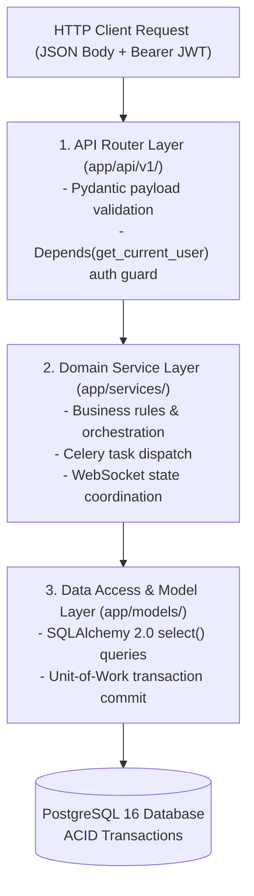
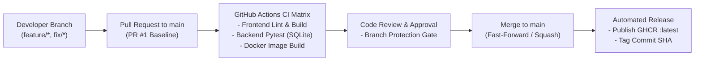

# StackForge — Engineering Standards, Rules & Conventions (`RULES.md`)

> **Document Classification:** Engineering Standards & Quality Governance  
> **Status:** Active Standard  
> **Target Audience:** Core Contributors, DevOps Engineers, System Architects, Technical Interview Panels  
> **Enforcement Scope:** Entire Repository (`frontend/`, `backend/`, `k8s/`, `terraform/`, `.github/workflows/`)

---

## 1. Core Engineering Philosophy

StackForge is engineered under strict production-readiness principles. Every line of code, infrastructure manifest, and pipeline definition adheres to the following core tenets:

### 1.1 The Twelve-Factor App Methodology
1. **Codebase:** One codebase tracked in Git (`main`), multiple deploys (local compose, staging, Kubernetes production).
2. **Dependencies:** Explicitly declared and isolated (`requirements.txt` for Python, `package.json` for Node.js). Never rely on ambient system tools.
3. **Config:** Strict separation of config from code. All database URLs, JWT signing secrets, Redis hostnames, and credentials are read from environment variables via Pydantic Settings.
4. **Backing Services:** Treat backing services (PostgreSQL, Redis, Prometheus, Loki) as attached resources reachable via URL endpoints with identical contracts across dev and prod.
5. **Build, Release, Run:** Strict separation between build stage (Docker multi-stage builds, compiling Next.js standalone assets), release stage (GHCR tag assignment, Alembic schema migrations), and run stage (supervising process loops).
6. **Processes:** Execute the app as stateless processes. Any state that needs to persist must be stored in PostgreSQL or Redis. Backend and Celery workers can be killed or scaled horizontally at any moment without data loss.
7. **Port Binding:** Self-contained services export HTTP/TCP by binding to local ports (FastAPI on `:8000`, Next.js on `:3000`, Prometheus on `:9090`).
8. **Concurrency:** Scale out via the process model. HTTP request concurrency is handled asynchronously by Uvicorn event loops; heavy background workloads are offloaded to distributed Celery worker processes.
9. **Disposability:** Fast startup and graceful shutdown. All services trap `SIGTERM` and `SIGINT`, finishing in-flight transactions and flushing buffers before exiting.
10. **Dev/Prod Parity:** Keep development, staging, and production as similar as possible. Docker Compose mirrors the multi-service topology used in Kubernetes.
11. **Logs:** Treat logs as continuous event streams. Applications stream unbuffered structured JSON to `stdout`/`stderr`. Loki and Alloy scrape these streams without local file log rotators.
12. **Admin Processes:** Run administrative or maintenance tasks (database migrations, one-off scripts) as one-off processes in identical environments against production databases.

### 1.2 Fail-Fast & Defensive Validation
- Validate at the boundary: All incoming network inputs (HTTP JSON bodies, URL query parameters, WebSocket messages, environment variables) must pass strict schema validation (Pydantic v2 in Python, Zod/TypeScript types in Next.js) before reaching business logic.
- Never catch generic `Exception` blindly. Catch specific operational exceptions (`HTTPException`, `IntegrityError`, `RedisError`) and return standardized error envelopes.
- Fail explicitly on startup if critical configuration is missing or malformed.

### 1.3 DRY & Explicit Over Magic
- Avoid copy-pasted domain logic, but favor clarity over premature abstraction.
- Explicit imports and explicit dependency injection over hidden globals or metaclass magic.

---

## 2. Python & FastAPI Backend Conventions

### 2.1 Pydantic v2 Schema Discipline
- All request payloads and response models must be defined as Pydantic models in `backend/app/schemas/`.
- Never return raw SQLAlchemy ORM model instances across API boundaries. Always serialize through Pydantic schemas using `model_config = ConfigDict(from_attributes=True)`.
- Use explicit field constraints:
  ```python
  from pydantic import BaseModel, Field, HttpUrl
  from typing import Optional

  class ProjectCreate(BaseModel):
      name: str = Field(..., min_length=2, max_length=50, description="Unique project slug")
      repo_url: HttpUrl = Field(..., description="Valid Git HTTPS repository URL")
      branch: str = Field(default="main", max_length=100)
  ```

### 2.2 SQLAlchemy 2.0 ORM & Query Standards
- Write all queries using SQLAlchemy 2.0 `select()` syntax. Legacy 1.x `session.query()` syntax is prohibited.
- Explicit type annotations on all ORM models using `Mapped[]` and `mapped_column()`:
  ```python
  from sqlalchemy.orm import Mapped, mapped_column, relationship
  from sqlalchemy import String, ForeignKey
  from app.db.base_class import Base

  class Deployment(Base):
      __tablename__ = "deployments"

      id: Mapped[str] = mapped_column(String(36), primary_key=True, index=True)
      project_id: Mapped[str] = mapped_column(String(36), ForeignKey("projects.id", ondelete="CASCADE"), nullable=False)
      status: Mapped[str] = mapped_column(String(20), default="QUEUED", index=True)
  ```
- Always define indexing on foreign keys, status filters, and search query columns.
- Ensure all sessions are managed via FastAPI dependency injection (`Depends(get_db)`) with automatic context closure.

### 2.3 Dependency Injection & Layered Architecture
StackForge enforces a strict three-tier architecture:
1. **API Routers (`app/api/v1/`):** Handle HTTP verbs, parameter extraction, auth checks, and call service functions. Zero direct database queries in route handlers.
2. **Services (`app/services/`):** Pure business logic (e.g., triggering deployments, computing infrastructure telemetry, managing WebSocket connections).
3. **Database Access / CRUD (`app/crud/` & `app/models/`):** Reusable queries and persistence interactions.



```python
# Standard Route Handler Pattern
@router.post("/", response_model=ProjectResponse, status_code=status.HTTP_201_CREATED)
async def create_project(
    payload: ProjectCreate,
    db: Session = Depends(get_db),
    current_user: User = Depends(get_current_active_user)
):
    project = project_service.create_user_project(db=db, user_id=current_user.id, data=payload)
    return project
```

### 2.4 Async Routes vs Synchronous Celery Workers
- Route handlers that perform fast I/O or database queries should be defined as `async def` or `def` depending on driver capabilities (psycopg2 is synchronous; FastAPI executes standard `def` routes in an optimized external thread pool, preventing event loop blocking).
- Any task exceeding **200 milliseconds** (building containers, running tests, external git cloning, healthcheck polling) must be offloaded to Celery:
  ```python
  from app.tasks.deployment_tasks import execute_deployment_task

  # Enqueue background execution via Celery on Redis broker
  task = execute_deployment_task.delay(deployment_id=deployment.id)
  ```

---

## 3. TypeScript & Next.js Frontend Conventions

### 3.1 Strict TypeScript & Zero Warnings
- `tsconfig.json` must enforce strict mode:
  ```json
  {
    "compilerOptions": {
      "strict": true,
      "noImplicitAny": true,
      "strictNullChecks": true,
      "noUnusedLocals": true,
      "noUnusedParameters": true
    }
  }
  ```
- The use of `any` is strictly prohibited. Use generics, interfaces, or unknown with type guards.
- All builds (`next build`) and linter checks (`eslint`) must pass with **0 errors and 0 warnings**.

### 3.2 Next.js App Router Architecture
- Maintain clear route group separation:
  - `app/(auth)/`: Login, registration, password recovery (minimal layout, no sidebar).
  - `app/(dashboard)/`: Authenticated developer cockpit (sidebar, breadcrumbs, user profile header, telemetry).
- Enforce the Client/Server Boundary:
  - Default to **React Server Components (RSC)** for initial data fetching, static layouts, and SEO headers.
  - Apply `'use client'` only to interactive boundary components: WebSocket subscribers, real-time charts, interactive forms, and terminal log windows.

### 3.3 State Management & HTTP Interceptors
- Centralize API communication via Axios instances in `lib/api/` or typed `fetch` wrappers.
- Automatically attach JWT Bearer tokens to request headers via interceptors:
  ```typescript
  apiClient.interceptors.request.use((config) => {
    const token = getAuthToken();
    if (token && config.headers) {
      config.headers.Authorization = `Bearer ${token}`;
    }
    return config;
  });
  ```
- Handle HTTP `401 Unauthorized` responses globally by clearing invalid tokens and routing the user to `/login`.

---

## 4. Git Workflow & Version Control Discipline



### 4.1 Commit Message Specification (Conventional Commits)
All commit messages must follow the Conventional Commits 1.0 specification:
`<type>(<optional scope>): <imperative description>`

**Allowed Types:**
- `feat`: A new user-facing capability or API endpoint.
- `fix`: A bug fix or defect resolution.
- `docs`: Documentation updates only (e.g., `docs(arch): update sequence diagram`).
- `style`: Formatting, missing semicolons, white-space changes (no code behavior change).
- `refactor`: Code restructuring without modifying public behavior or fixing bugs.
- `test`: Adding missing unit tests or refactoring test suites.
- `chore`: Build system changes, package version bumps, Dockerfile updates, CI configs.

### 4.2 Branch Naming Conventions
- `main`: Protected production branch. All code must pass CI before merging.
- `feature/<ticket-or-slug>`: New feature work (e.g., `feature/k8s-pod-runner`).
- `fix/<issue-description>`: Bug fixes (e.g., `fix/docker-compose-k8s-fix`).
- `docs/<doc-subject>`: Documentation enhancements.

### 4.3 Verified Author Identity
All commits must be made using the verified author credentials to preserve Git audit history:
- **Name:** `Ashwin Satvi`
- **Email:** `satviashwin369@gmail.com`

---

## 5. Security & Secret Governance

### 5.1 Zero Secret Leakage Policy
- **Never** commit passwords, API keys, private keys, or JWT secret tokens into Git.
- All secrets must be injected at runtime via environment variables or Kubernetes Secrets.
- `.gitignore` must strictly exclude `.env`, `.env.local`, `*.pem`, `*.key`, and `credentials.json`.
- A sanitized `.env.example` file must be maintained in the root showing placeholder keys.

### 5.2 Stateless JWT Authentication
- Passwords must be hashed using `bcrypt` with a minimum work factor of 12 before database persistence.
- JWT access tokens must have a strict expiration time (`ACCESS_TOKEN_EXPIRE_MINUTES = 60 * 24` or 1 hour in production).
- Use `python-jose` with `HS256` or `RS256` cryptographic signing algorithms.
- Verify user existence and active status on every authenticated request via token payload subject verification (`sub: user_id`).

### 5.3 Container Hardening & Least Privilege
- Production container images must run as a non-privileged user:
  - Frontend: `USER nextjs` (UID 1001) in `frontend/Dockerfile`.
  - Backend: Dedicated non-root user in production Dockerfile.
- Multi-stage builds are required to eliminate compiler toolchains, package managers, and development headers from production runtime images.
- Containers must never mount the host Docker socket (`/var/run/docker.sock`) directly in untrusted execution contexts.

### 5.4 Network & CORS Whitelisting
- FastAPI CORS middleware must only permit explicit trusted origins. Wildcard `allow_origins=["*"]` is strictly forbidden in production:
  ```python
  app.add_middleware(
      CORSMiddleware,
      allow_origins=settings.CORS_ORIGINS,  # ["http://localhost:3000", "https://stackforge.io"]
      allow_credentials=True,
      allow_methods=["GET", "POST", "PUT", "DELETE", "PATCH", "OPTIONS"],
      allow_headers=["*"],
  )
  ```

---

## 6. Testing Discipline & Quality Assurance

### 6.1 Test Isolation & Hermetic Environments
- Tests must execute independently without requiring an active external PostgreSQL or Redis server running.
- In `backend/tests/conftest.py`, the database engine is substituted with an in-memory SQLite engine (`sqlite:///:memory:`) using `StaticPool`.
- The `redis` module is mocked before importing application routes to prevent socket connection attempts during unit test runs:
  ```python
  if "redis" not in sys.modules:
      sys.modules["redis"] = MagicMock()
  ```
- Each test gets an isolated transaction context via FastAPI's `app.dependency_overrides[get_db]`.

### 6.2 Testing Standards
- All endpoints must have corresponding integration tests covering:
  1. **Happy path:** Valid payload returns expected status code and schema.
  2. **Validation error:** Malformed input triggers HTTP 422 with validation errors.
  3. **Unauthorized access:** Missing or invalid Bearer token returns HTTP 401.
  4. **Forbidden action:** Accessing another tenant's project returns HTTP 403 or 404.
- Test suites must execute completely within **under 30 seconds** in CI pipelines.

---

## 7. Observability & Telemetry Governance

### 7.1 Prometheus Metrics Standards
- All metric names must follow standard Prometheus conventions:
  - Counter: `<subsystem>_<noun>_total` (e.g., `stackforge_deployments_total{status="SUCCESS"}`)
  - Histogram / Summary: `<subsystem>_<noun>_duration_seconds` (e.g., `stackforge_deployment_duration_seconds`)
  - Gauge: `<subsystem>_<noun>_active` or `<subsystem>_<noun>_gauge`
- Metric labels must maintain low cardinality (e.g., `status`, `stage`, `project_id`). Never use arbitrary user input, deployment logs, or timestamps as metric labels.

### 7.2 Structured Logging & Log Sanitization
- All application logging must use `structlog` or standard Python `logging` formatted as JSON in production.
- Logs must include trace context: `request_id`, `user_id`, `project_id`, `deployment_id`.
- Sensitive tokens, credentials, and passwords must be automatically redacted before writing to log streams.

