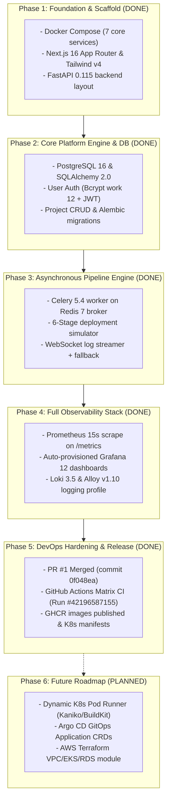

# StackForge — Work Breakdown Structure & Milestone History (`TASK.md`)

> **Document Classification:** Engineering Project Management, Milestone Audit & Roadmap  
> **Status:** Active Tracking Document  
> **Target Audience:** Engineering Leads, DevOps Architects, Technical Interview Panels  
> **Repository:** `satviashwin369-creator/stackforge`  
> **Base Branch:** `main` | **Latest Merge PR:** `#1` (`0f048ea`)

---

## 1. Executive Summary & Delivery Overview

StackForge was developed iteratively across five core phases to transform a conceptual cloud orchestration idea into a production-hardened developer platform. Every phase introduced specific architectural layers, automated verification tests, and operational observability infrastructure.

---

## 2. Phase-by-Phase Work Breakdown Structure (WBS)

### Phase 1: Foundation & Infrastructure Scaffolding
- **Status:** COMPLETED
- **Objectives:** Establish development environment, multi-container Docker Compose topology, and baseline framework scaffolds.
- **Key Deliverables:**
  - `docker-compose.yml`: Configured multi-service architecture including `stackforge-frontend`, `stackforge-backend`, `stackforge-db` (PostgreSQL 16), and `stackforge-redis` (Redis 7).
  - Next.js 16 frontend scaffold with App Router, Tailwind CSS v4, Base UI, and Lucide React.
  - FastAPI 0.115 backend scaffold with structured project directory (`api/`, `core/`, `db/`, `models/`, `schemas/`, `services/`, `tasks/`).
  - `.env.example` template isolating local configuration parameters.

### Phase 2: Core Platform Engine & Data Persistence
- **Status:** COMPLETED
- **Objectives:** Implement user authentication, relational schemas, and project management APIs.
- **Key Deliverables:**
  - PostgreSQL schema design and SQLAlchemy 2.0 ORM models:
    - `User`: Email-based identity with bcrypt-hashed passwords.
    - `Project`: Git repository metadata, branch configurations, and owner associations.
    - `Deployment`: Pipeline run records, commit SHAs, status state machine, and timestamps.
    - `DeploymentLog`: Structured log persistence linked to individual deployment runs.
  - Alembic database migration environment (`backend/alembic/`) for declarative schema versioning.
  - JWT Authentication subsystem: OAuth2 password flow, bearer token generation via `python-jose`, and route authorization dependencies (`get_current_user`, `get_current_active_user`).
  - Project management CRUD endpoints (`/api/v1/projects`).

### Phase 3: Distributed Execution & Real-Time Engine
- **Status:** COMPLETED
- **Objectives:** Offload pipeline execution from the HTTP request loop and stream real-time logs to the UI.
- **Key Deliverables:**
  - Celery 5.4 distributed task worker integration configured with Redis 7 as the message broker and result backend.
  - Deployment simulator engine (`backend/app/services/deployment_simulator.py`):
    - Emulates the 6 canonical deployment pipeline stages (`CLONE`, `INSTALL`, `LINT_TEST`, `BUILD`, `PUSH_REGISTRY`, `DEPLOY_K8S`).
    - Employs realistic failure rates (10% random test failure, 5% random registry network timeout) to thoroughly exercise client error handling.
  - Redis Pub/Sub integration (`app/services/log_streamer.py`):
    - Worker publishes log events to Redis channel `deployments:{id}:logs`.
    - FastAPI WebSocket route (`/ws/deployments/{id}/logs`) subscribes to Redis channel and pushes events directly to connected browsers.
  - Live Console UI component (`frontend/components/dashboard/LiveConsole.tsx`):
    - Real-time terminal log rendering, circular memory buffer (1,000 lines), ANSI stage highlighting, auto-scroll with manual scroll pause lock.

### Phase 4: Production Observability Stack
- **Status:** COMPLETED
- **Objectives:** Implement comprehensive monitoring, metrics collection, centralized log aggregation, and dashboard visualization.
- **Key Deliverables:**
  - Prometheus integration (`backend/app/main.py`):
    - Custom Prometheus middleware instrumenting request counts, latency histograms, and deployment counters.
    - Exported metrics scrape endpoint at `/metrics`.
  - Prometheus Server (`stackforge-prometheus`): Configured scrape job targeting `stackforge-backend:8000` with 15s evaluation interval.
  - Grafana 12.1 (`stackforge-grafana`):
    - Automated provisioning of Prometheus and Loki datasources (`grafana/provisioning/datasources/`).
    - Pre-configured dashboard JSON (`grafana/provisioning/dashboards/`) tracking deployment throughput, success/failure ratios, and HTTP request latency.
    - Admin password reset automation verified via `grafana-cli`.
  - Loki 3.5 & Alloy 1.10 (`stackforge-loki`, `stackforge-alloy`):
    - Centralized log streaming and aggregation pipeline.

### Phase 5: CI/CD, Containerization, Kubernetes & DevOps Hardening
- **Status:** COMPLETED
- **Objectives:** Enforce code quality in CI, publish production container images to GHCR, establish Kubernetes manifests, and harden infrastructure definitions.
- **Key Deliverables:**
  - GitHub Actions Workflow (`.github/workflows/ci.yml`):
    - Matrix pipeline executing Next.js build & ESLint, Python backend test suite via in-memory SQLite fixture, and Docker image builds.
    - Automated publishing of production multi-stage images to GitHub Container Registry (GHCR):
      - `ghcr.io/satviashwin369-creator/stackforge-backend:latest`
      - `ghcr.io/satviashwin369-creator/stackforge-frontend:latest`
  - Pull Request #1 (`refactor/devops-hardening` -> `main`):
    - Hardened Kubernetes manifests (`k8s/`): Non-root security contexts (`runAsNonRoot: true`, `readOnlyRootFilesystem: true`, `drop: ["ALL"]`), resource limits/requests, and untracking of sensitive secret files.
    - Hardened Terraform definitions (`terraform/`): Parameterized variable blocks, provider version constraints, and state locking scaffolds.
    - Hardened WebSocket endpoint: Enforced mandatory JWT token authentication query parameter (`?token=...`) on `/ws/deployments/{id}/logs`.
    - Fixed test fixture lifecycle in `backend/tests/conftest.py` with import-time engine patching.
    - PR merged cleanly into `main` at commit `0f048ea`.

---

## 3. Pull Request #1 Audit Record & Verification

The hardening milestone was executed via Pull Request #1 and merged into `main`:

| Attribute | Details |
| :--- | :--- |
| **Pull Request** | `#1` (`refactor/devops-hardening` into `main`) |
| **Merge Commit SHA**| `0f048ea33df939a4e0de0142f46a06683864e762` |
| **Author** | `Ashwin Satvi <satviashwin369@gmail.com>` |
| **CI/CD Workflow** | GitHub Actions Run `#42196587155` |
| **Pipeline Outcome**| **SUCCESS** (Frontend Build: PASS, Backend Tests: PASS, GHCR Push: PASS) |
| **Published Artifacts** | `ghcr.io/satviashwin369-creator/stackforge-backend:latest` `ghcr.io/satviashwin369-creator/stackforge-frontend:latest` |

### Key Commits Comprising PR #1:
- `640b9b7`: docs: finalize README, project log, and architecture documentation
- `e04fd2c`: fix(tests): align standalone test runner with test functions
- `581088a`: docs(log): fix stale milestone status, correct secret.yaml reference, record E1.2 fix
- `da3f919`: fix(tests): patch app.db.session and app.main engines before TestClient lifespan
- `3b7cb12`: refactor(k8s): harden pod security contexts and untrack local secret manifest
- `1a9ca4a`: refactor(terraform): parameterize credentials and harden variable declarations
- `08915e3`: fix(security): enforce WebSocket JWT authentication and least-privilege CI permissions
- `c3978a7`: fix: sort PEP 8 imports and add exception resilience to Prometheus middleware in main.py
- `631f9ca`: docs: record comprehensive current-state assessment and architecture snapshot

---

## 4. Current State: Real vs Simulated Subsystems

To maintain complete transparency for technical interviews, the following table audits the exact implementation boundary between real production logic and simulated components:

| Subsystem | Real or Simulated? | Code Location | Technical Description |
| :--- | :--- | :--- | :--- |
| **User Authentication** | **100% REAL** | `backend/app/api/v1/auth.py`, `app/core/security.py` | Real bcrypt hashing, genuine JWT generation, token signature verification, and PostgreSQL user persistence. |
| **REST APIs & CRUD** | **100% REAL** | `backend/app/api/v1/projects.py`, `app/api/v1/deployments.py` | Genuine FastAPI route execution, Pydantic validation, and SQLAlchemy database commits. |
| **Celery Worker Execution** | **100% REAL** | `backend/app/tasks/deployment_tasks.py` | Real distributed worker process consuming tasks from Redis broker over TCP. |
| **Redis Pub/Sub & WebSockets**| **100% REAL** | `backend/app/services/log_streamer.py`, `app/api/v1/ws.py` | Real Redis pub/sub messaging and live bidirectional WebSocket frames to browser. |
| **Prometheus & Grafana** | **100% REAL** | `docker-compose.yml`, `grafana/`, `backend/app/main.py` | Real Prometheus metric scraping, real time-series storage, and genuine Grafana dashboards. |
| **Pipeline Stage Progression** | **SIMULATED** | `backend/app/services/deployment_simulator.py` | Emulates shell execution times (`sleep`), fake ANSI build traces, and synthetic exit codes. Does not invoke local Docker daemon. |
| **Cluster Node Cards** | **SIMULATED** | `backend/app/services/infra_service.py` | Generates randomized CPU, memory, and pod counts for virtual nodes (`node-01`, `node-02`) rather than querying the Kubernetes Metrics Server API. |

---

## 5. Future Roadmap & Milestones (Phase 6+)

### Phase 6: Dynamic Kubernetes Pod Runner
- **Goal:** Replace `deployment_simulator.py` with real Kubernetes Pod execution.
- **Architecture:** When Celery receives `execute_deployment`, it uses the official `kubernetes` Python client to spawn an ephemeral Pod inside a Kubernetes cluster (`Kaniko` or `BuildKit` container).
- **Log Streaming:** Attach to the Pod's stdout via `client.CoreV1Api().read_namespaced_pod_log(follow=True)` and pipe chunks directly into Redis Pub/Sub.

### Phase 7: GitOps Integration & Enterprise Secret Management
- **Goal:** Declarative synchronization of cluster state and secure secret storage.
- **Deliverables:**
  - Argo CD `Application` custom resources pointing to `k8s/` manifests in Git.
  - External Secrets Operator (ESO) syncing credentials from AWS Secrets Manager or HashiCorp Vault into Kubernetes `Secret` objects.

### Phase 8: Cloud Infrastructure Automation via Terraform
- **Goal:** 100% automated provisioning of production cloud infrastructure.
- **Target Architecture (AWS):**
  - Amazon EKS cluster with managed node groups.
  - Amazon RDS PostgreSQL Multi-AZ instance.
  - Amazon ElastiCache for Redis cluster.
  - Application Load Balancer (ALB) with AWS Certificate Manager (ACM) TLS termination.

